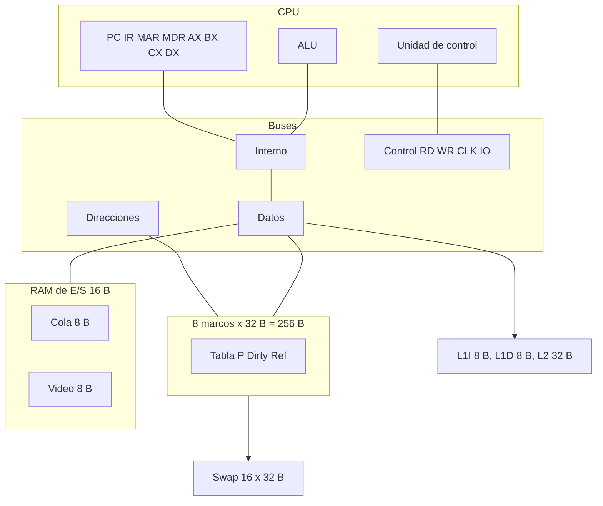

# Simulador de CPU — Arquitectura de Computadoras (SIS-131)

Universidad Católica Boliviana San Pablo. Docente: Ing. Paulo César Loayza Carrasco.

CPU de un núcleo, un proceso y un hilo. Registros AX, BX, CX, DX, PC, IR, MAR, MDR. Banderas ZF, CF y SF.

| Integrante | GitHub | Módulos que ya están en los PR mergeados a `develop` |
| --- | --- | --- |
| Alain Flores | [@alainflores-T](https://github.com/alainflores-T) | CPU, buses, buffers, palabra de control, ISA |
| Juan Escalante | [@Gunter310](https://github.com/Gunter310) | Marcos, swap, MMU, reemplazo, caché |
| Chry | [@ChryzzMT](https://github.com/ChryzzMT) | Catálogo, editor, ensamblador, cargador, teclado, LCD, UI |

**Nombre oficial y logotipo:** pendientes de acuerdo del equipo (issue [#12](https://github.com/alainflores-T/Proyecto-SimuladorCPU-I00/issues/12)). Esta rama no inventa ni dibuja un logo.

**Hoja de referencia (no modificada por esta rama):** [Ciclodeinstruccion](https://docs.google.com/spreadsheets/d/1RnR5stD-B3N6SorOEXixn78WR9USc9oh7loojdVo1MI/edit?usp=sharing)

El script hay que pegarlo en una **copia**. Pasos: [`docs/despliegue-copia.md`](docs/despliegue-copia.md).

## Arquitectura



La palabra de control y su HEX están en [`docs/control-word.md`](docs/control-word.md). La ISA está en [`docs/ISA.md`](docs/ISA.md). La decisión de no recortar un marco para la E/S está en [`docs/decision-es-vm.md`](docs/decision-es-vm.md).

Un bus sin conductor muestra `ZZ`. Si dos componentes tienen `En=1` en el mismo bus, `transfer` no escribe el destino, pone `HALT` y lanza el error. `recuperarContencion` vuelve a `READY` con los buses en alta impedancia.

## Memoria y caché

- Física: 256 B, marcos 0 a 7, 32 B. Solo los marcos 0 a 6 reciben páginas.
- El marco 7 es la E/S: F0H–F7H teclado, F8H–FFH LCD. E0H–EFH es relleno de ese marco, dentro de los 256 B.
- Virtual: 512 B, páginas 0 a 15. La traducción no cae en el marco 7.
- Fallo: con los 7 marcos elegibles llenos, FIFO o LRU elige la víctima entre ellos. Si está sucia, 32 B vuelven al swap. F0H–FFH no se pisan.
- El `LOAD` deja la política **FIFO** visible en la hoja Reemplazo. `usarLRU` la cambia.
- L1I y L1D: una línea de 8 B cada una. L2: 4 líneas de 8 B, correspondencia directa. Escritura write-through. L2 solo cuenta cuando L1 falla. `FETCH_3` reutiliza la lectura de `FETCH_2` y no suma otro miss.

## E/S

`IN reg, [KBD]` y `OUT [LCD], reg` usan el bus de datos y las celdas F0H–FFH. Conviven con un programa paginado. Un `IN` con la cola vacía entrega `00H` y no mueve la cabeza.

## Controles

| Control | Qué hace |
| --- | --- |
| LOAD | Ensambla el programa de `Directory!B1`, lo escribe en el swap, elige FIFO y deja las páginas ausentes |
| STEP | Un micro-paso, si no hay un RUN con token vigente |
| RUN | Lotes de 16 micro-pasos. El panel pide el siguiente lote. No hay un bucle hasta `HALT` dentro del servidor |
| PAUSE | El lote siguiente no ejecuta pasos. Un menú no puede cortar una llamada que aún no regresó |
| RESET | PC, IR, MAR, MDR, AX–DX, flags y buses a READY. No vacía marcos, swap, caché ni E/S |
| CLEAR | Vacía la RAM física y la presencia de las páginas. Conserva el swap del último LOAD, incluidos los write-back ya hechos |

`onOpen` solo crea menús. `prepararSimulador` crea las hojas que faltan y no pisa una hoja ajena.

El panel (`src/Panel.html`) pinta el snapshot de `uiSnapshot`: registros, ALU, buses, contadores, páginas presentes, cola y LCD. Los colores de hit y miss salen de los eventos que anotó la caché.

## Programas

Hay ocho fuentes en `programs/` y en el catálogo. Las tres de la rúbrica:

1. `arithmetic-ax-dx.asm` — AX = BX × CX por sumas.
2. `keyboard-lcd-echo.asm` — ocho caracteres de la cola al LCD.
3. `scattered-access.asm` — nueve páginas, escrituras sucias, fallos y misses.

Trazas previstas y las cifras medidas con el mock: [`docs/program-traces.md`](docs/program-traces.md).

## Prueba automática

```bash
node tests/run-motor.js
```

Ejecuta los `.gs` de `src/` con un libro en memoria. Cubre sintaxis, los tres programas por `loadSelectedProgram` y `uiLoteRun`, contención, pausa, reset, clear, FIFO, fallos, write-back y el HEX de IN/OUT. No abre la hoja de Google.

## Manual breve

1. Preparar hojas.
2. Inicializar el catálogo y elegir el programa.
3. LOAD.
4. Para el eco, encolar ocho bytes antes de RUN.
5. Abrir el panel y pulsar RUN. PAUSE entre lotes. RESET para repetir con la memoria residente. CLEAR para volver a fallos de página sobre el mismo swap.
