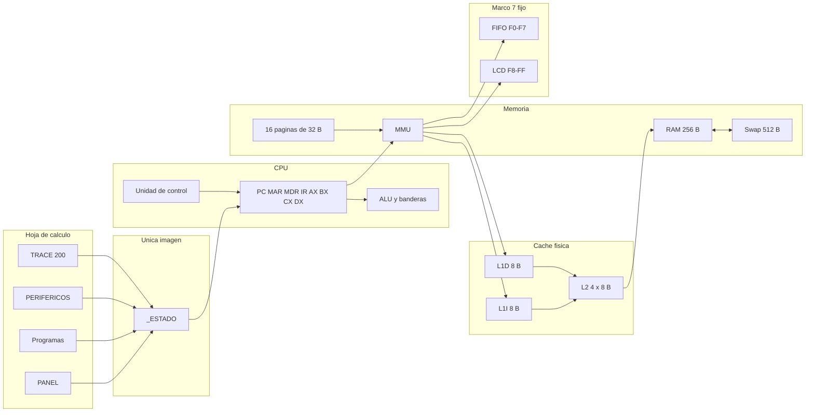
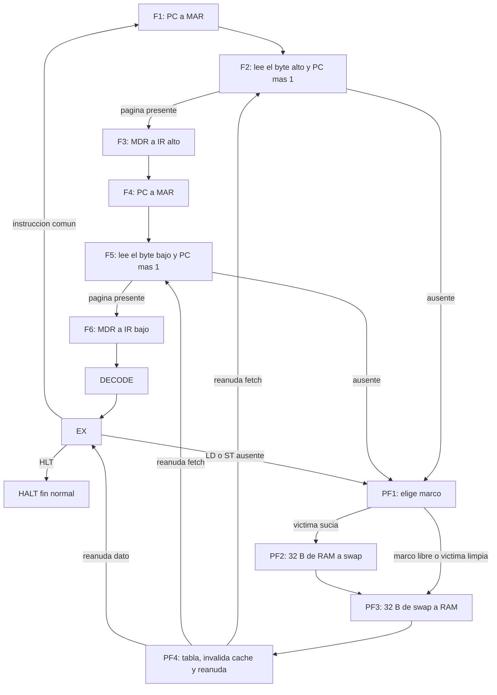
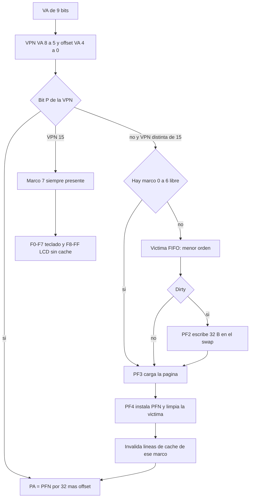
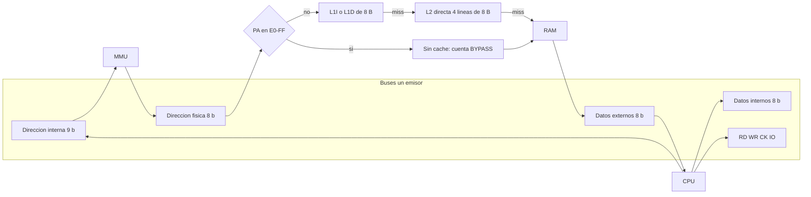
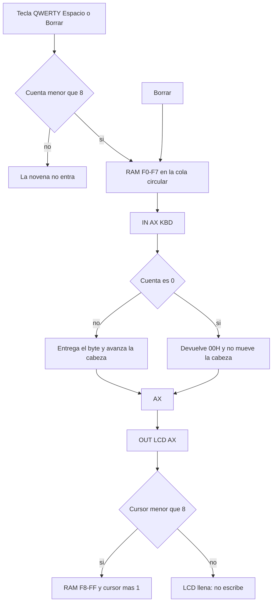

# Simulador avanzado de arquitectura de computadoras


[Español](README.md) | [English](README_EN.md)

**Materia:** Arquitectura de Computadoras (SIS-131), Universidad Católica Boliviana "San Pablo", Unidad Académica Regional Santa Cruz.
**Docente:** Ing. Paulo César Loayza Carrasco.
**Semestre:** 2/2026.
**Repositorio:** [alainflores-T/Proyecto-SimuladorCPU-I00](https://github.com/alainflores-T/Proyecto-SimuladorCPU-I00).
**Equipo:** Alain Anthony Flores Tapia ([alainflores-T](https://github.com/alainflores-T)), Juan ([Gunter310](https://github.com/Gunter310)) y Chry ([ChryzzMT](https://github.com/ChryzzMT)).

El nombre oficial y el logo del equipo se muestran en la hoja del simulador (issue #12). No constan como texto en este repositorio: si hace falta citarlos en la portada, hay que tomarlos de esa hoja.

Copia validada en Google Sheets (interfaz principal). El motor documentado aquí es el de la rama `develop`, alineado con la punta `9ab18d4` de `cursor/visual-lab-9a2-a0e8`. El diálogo HTML es auxiliar. Los originales no se modifican.

**Hoja:** <https://docs.google.com/spreadsheets/d/1CKb2nxVO2tstUjwY1s5clJ1ME9Di0lNIpk8voLzeS20/edit>

**Proyecto de Apps Script de esa copia:** `1yTRwU6iB3LEfVmbfgtJ4zxun26nDwDUNQB5t3nJ_WPCnoJQD6WwEQvzD`.

Esta documentación describe esa copia y el código de `src/` en `develop`. El detalle ampliado sigue en [docs/arquitectura.md](docs/arquitectura.md), [docs/ISA.md](docs/ISA.md), [docs/control-word.md](docs/control-word.md), [docs/manual.md](docs/manual.md), [docs/program-traces.md](docs/program-traces.md), [docs/matriz.md](docs/matriz.md) y [docs/GUIA_DEFENSA.md](docs/GUIA_DEFENSA.md).

## 1. Qué ejecuta

ISA fija de 2 bytes. El fetch siempre lee los dos. Registros PC, MAR, MDR, IR, AX, BX, CX y DX. Banderas ZF, CF y SF. RAM física de 256 bytes (8 marcos de 32), espacio virtual de 512 bytes (16 páginas de 32) y swap de 512 bytes. Los marcos 0 a 6 son paginables. El marco 7 pertenece a la VPN 15, está siempre presente y no se reemplaza: ahí están el teclado `F0`–`F7` y el LCD `F8`–`FF`. Caché L1I de 8 bytes, L1D de 8 bytes y L2 directa de 4 líneas de 8, con etiquetas físicas. Un emisor por bus; dos emisores dejan la fase en `ERROR`.

`STEP` avanza un micro-paso, no una instrucción. `HLT` es el fin normal. Un fallo de página es el camino normal cuando la VPN no está en RAM (fases PF1 a PF4), no la fase `ERROR`.

La imagen vive en la hoja oculta `_ESTADO`. PANEL, Programas, PERIFERICOS y TRACE leen o escriben esa imagen. No hay una segunda RAM. El diálogo `Laboratorio.html` pide el mismo estado por `simLabPaso` y `simLabEstado`.

## 2. Arquitectura

Fuente: [docs/diagramas/arquitectura.mmd](docs/diagramas/arquitectura.mmd).



## 3. Ciclo de instrucción

Cada llamada a `simMicroPaso` ejecuta la fase actual y deja la siguiente. Fetch lee dos bytes: el alto entra en F2 y el bajo en F5. PC aumenta en cada una de esas lecturas. Decode no mueve registros. Execute depende del opcode. `HLT` pasa a `HALT` y ahí se queda.

Si la VPN no está presente, ese paso se anota como PF1 y elige marco. La víctima sucia pasa por PF2 (write-back de 32 bytes al swap) antes de PF3 (carga de 32 bytes desde el swap). PF4 actualiza la tabla, invalida las líneas de caché de ese marco y reanuda F2, F5 o EX, según dónde se cortó el acceso.

Fuente: [docs/diagramas/ciclo.mmd](docs/diagramas/ciclo.mmd).



## 4. Memoria virtual, tabla de marcos y Page Fault

La dirección virtual tiene 9 bits. La VPN son los bits 8 a 5 y el desplazamiento los bits 4 a 0. La dirección física es `PFN * 32 + desplazamiento` (8 bits). Hay 16 páginas virtuales. Los marcos 0 a 6 se reemplazan. El marco 7 pertenece a la VPN 15, está siempre presente y no puede ser víctima. Un fallo pedido sobre la VPN 15 termina en `ERROR`.

La política guardada con los programas es FIFO: sale la página con menor `orden`. El código también sabe elegir por `uso` si la política es `LRU`. Esa política no es la de P1, P2 ni P3, y no se midió en la hoja.

En el P3 medido hubo 11 fallos, en este orden de VPN: 0, 2, 5, 9, 14, 3, 7, 11, 0, 12, 4. Los siete primeros ocupan los marcos 0 a 6. Los cuatro siguientes reemplazan. El único write-back fue la VPN 9, sucia, al salir del marco 3 cuando entró la VPN 4. El rótulo «Último fallo» se queda en el último evento. No significa que la CPU siga en fallo: P3 termina en `HLT`.

Fuente: [docs/diagramas/paginacion.mmd](docs/diagramas/paginacion.mmd).



### Mapa de memoria

| Región | Rango | Tamaño | Notas |
| --- | --- | --- | --- |
| Espacio virtual | `000`–`1FF` | 512 B | 16 páginas de 32 B. VA = VPN (bits 8–5) + offset (bits 4–0). |
| RAM física | `00`–`FF` | 256 B | 8 marcos de 32 B. |
| Marcos paginables | 0–6 | 224 B | Únicos elegibles para reemplazo FIFO. |
| Marco 7 (VPN 15) | `E0`–`FF` | 32 B | Siempre presente. No es víctima. Las direcciones `E0`–`FF` no consultan la caché (se anota `BYPASS`). |
| Cola de teclado | `F0`–`F7` | 8 B | FIFO circular en el marco 7. |
| Buffer del LCD | `F8`–`FF` | 8 B | Ocho caracteres. Un noveno `OUT` no escribe. |
| Swap | 16 páginas de 32 B | 512 B | Respaldo de las páginas virtuales. |

`LD`, `ST`, los saltos y `DB` rechazan la ventana virtual `1E0`–`1FF` (E/S de la VPN 15). Para el teclado y el LCD se usan `IN` y `OUT`.

## 5. Caché L1I / L1D / L2 y buses

Hay cuatro buses de datos o dirección y las líneas RD, WR, CK e IO. Cada bus tiene un emisor (buffer tri-estado: el resto queda en alta impedancia). Si dos quieren escribir, el paso pasa a `ERROR` y no actualiza el destino.

L1I y L1D tienen una línea de 8 bytes. L2 es de correspondencia directa, índice `(PA >> 3) & 3`, etiqueta física `PA >> 5`. Se consulta después de la MMU. Escritura inmediata (write-through) y asignación en fallo (write-allocate). La línea no tiene bit dirty. Un acierto de escritura en L1D actualiza la RAM y, si la línea de L2 coincide, también ese byte. Ese mantenimiento suma `mant` y no entra en la tasa de L2. L2 solo cuenta la demanda que llega por un fallo de L1.

Las direcciones físicas `E0`–`FF` no consultan la caché. Al reemplazar un marco se invalidan las líneas cuya base cae en esos 32 bytes.

En el P3 medido: L1I 19 aciertos y 3 fallos (86,4 %), L1D 0 aciertos y 9 fallos (5 de `LD` y 4 de `ST`), L2 0 aciertos y 12 fallos. 3 + 9 = 12.

Fuente: [docs/diagramas/cache-buses.mmd](docs/diagramas/cache-buses.mmd).



## 6. Periféricos de E/S

La cola es circular de 8 bytes en `F0`–`F7`, con cabeza, cola y cuenta. Borrar retrocede la cola y pone ese byte en 0. `IN reg, [KBD]` lee la cabeza. Si la cuenta es 0, el registro destino recibe `00` y la cabeza no se mueve: no espera una tecla. `OUT [LCD], reg` escribe en `F8` más el cursor, hasta 8 caracteres. El noveno `OUT` no avanza. Ninguno de los dos pasa por L1 ni por L2.

En la pestaña PERIFERICOS hay filas QWERTY, Espacio y Borrar. Cada tecla es una celda. La novena tecla no entra.

Fuente: [docs/diagramas/es.mmd](docs/diagramas/es.mmd).



## 7. ISA

Todas las instrucciones ocupan 2 bytes.

Byte 0: opcode de 5 bits en las posiciones 7 a 3, registro destino en los bits 2 y 1, y el bit 8 de la dirección en el bit 0.
Byte 1: inmediato, parte baja de la dirección, o registro fuente en los dos bits bajos.

`b0 = (opcode << 3) | (registro << 1) | A8`. Registros: AX 0, BX 1, CX 2, DX 3.

| Mnemónico | Opcode | Forma | Bytes | Banderas | Descripción |
| --- | --- | --- | --- | --- | --- |
| NOP | 0 | `NOP` | 2 | no | No opera. |
| HLT | 1 | `HLT` | 2 | no | Fin normal. La fase queda `HALT`. Se codifica `08 00`. |
| MOV inmediato | 2 | `MOV reg, imm` | 2 | no | Carga un inmediato. |
| MOV registro | 3 | `MOV reg, reg` | 2 | no | Copia entre registros. |
| LD | 4 | `LD reg, [dir]` | 2 | no | Carga desde memoria virtual (vía MMU y L1D). |
| ST | 5 | `ST [dir], reg` | 2 | no | Guarda en memoria virtual (vía MMU y L1D). |
| ADD inmediato | 6 | `ADD reg, imm` | 2 | ZF, CF, SF | Suma con inmediato. |
| ADD registro | 7 | `ADD reg, reg` | 2 | ZF, CF, SF | Suma con registro. |
| SUB inmediato | 8 | `SUB reg, imm` | 2 | ZF, CF, SF | Resta con inmediato. |
| SUB registro | 9 | `SUB reg, reg` | 2 | ZF, CF, SF | Resta con registro. |
| AND inmediato | 10 | `AND reg, imm` | 2 | ZF, SF. CF no cambia | AND con inmediato. |
| AND registro | 11 | `AND reg, reg` | 2 | ZF, SF. CF no cambia | AND con registro. |
| OR inmediato | 12 | `OR reg, imm` | 2 | ZF, SF. CF no cambia | OR con inmediato. |
| OR registro | 13 | `OR reg, reg` | 2 | ZF, SF. CF no cambia | OR con registro. |
| CMP inmediato | 14 | `CMP reg, imm` | 2 | ZF, CF, SF. No escribe el registro | Compara con inmediato. |
| CMP registro | 15 | `CMP reg, reg` | 2 | ZF, CF, SF. No escribe el registro | Compara con registro. |
| INC | 16 | `INC reg` | 2 | ZF, CF, SF | Incrementa. |
| DEC | 17 | `DEC reg` | 2 | ZF, CF, SF | Decrementa. |
| JMP | 18 | `JMP dir` | 2 | no | Salto incondicional. |
| JZ | 19 | `JZ dir` | 2 | no | Salta si ZF = 1. |
| JNZ | 20 | `JNZ dir` | 2 | no | Salta si ZF = 0. |
| JC | 21 | `JC dir` | 2 | no | Salta si CF = 1. |
| IN | 22 | `IN reg, [KBD]` | 2 | no | Lee la cola del teclado. |
| OUT | 23 | `OUT [LCD], reg` | 2 | no | Escribe un carácter en el LCD. |

No hay `JS`. CF de una resta es 1 si el resultado es negativo antes de quedarse en 8 bits. SF es el bit 7 del resultado. ZF es el resultado en cero. MOV no toca las banderas.

Ejemplo medido en el listado de P3: `LD AX, [40H]` queda `20 40`. Opcode 4, registro 0 y dirección `040` dan el byte alto `20` y el bajo `40`. `HLT` queda `08 00`, que es el IR `0800` al final de P3.

## 8. Palabra de control

Cada micro-paso publica 28 señales, en este orden, cada una en 0 o en 1. El panel las concatena sin espacios. El bit de la izquierda es `En_PC`.

`En_PC`, `Ld_MAR`, `Mem_R`, `Mem_W`, `Ld_MDR`, `En_MDR`, `Ld_IRH`, `Ld_IRL`, `En_ALU`, `Ld_ALU`, `Ld_AX`, `En_AX`, `Ld_BX`, `En_BX`, `Ld_CX`, `En_CX`, `Ld_DX`, `En_DX`, `Ld_PC`, `En_IR`, `En_MAR`, `INC_PC`, `IO`, `En_KBD`, `Ld_LCD`, `ALU2`, `ALU1`, `ALU0`.

`En_` pone el valor del componente en el bus. `Ld_` carga en el componente lo que hay en el bus.

| Fase | Señales |
| --- | --- |
| F1 y F4 | `En_PC`, `Ld_MAR`. La dirección interna sale de PC. |
| F2 y F5 | `Mem_R`, `En_MAR`, `Ld_MDR`, `INC_PC`. PC aumenta. |
| F3 | `En_MDR`, `Ld_IRH`. |
| F6 | `En_MDR`, `Ld_IRL`. |
| DECODE | Ninguna transferencia. Publica el texto de la instrucción. |

En Execute las señales dependen de la operación. La ALU usa `ALU2`, `ALU1` y `ALU0` con este código: MOV 0, ADD 1, SUB 2, AND 3, OR 4, CMP 5, INC 6, DEC 7. CMP enciende la ALU y no carga el registro destino. `IN` enciende `IO`, `Mem_R` y `En_KBD`. `OUT` enciende `IO`, `Mem_W` y `Ld_LCD`.

## 9. Manual de uso

No hace falta una aplicación web. El manifiesto solo lleva estos dos ámbitos:

- `https://www.googleapis.com/auth/spreadsheets.currentonly`
- `https://www.googleapis.com/auth/script.container.ui`

### Archivos del proyecto de la copia

Pegue estos diez archivos en el proyecto de Apps Script de la copia, con el mismo nombre:

| Archivo | Papel |
| --- | --- |
| `Estado.gs` | Imagen única: registros, RAM, swap, tabla, caché, traza. |
| `Cache.gs` | L1I, L1D y L2. |
| `Memoria.gs` | Traducción, FIFO y fallo de página. |
| `ES.gs` | Cola de 8 y LCD de 8. |
| `CPU.gs` | Un micro-paso por llamada. |
| `Ensamblador.gs` | Catálogo P1, P2 y P3, y el ensamblador. |
| `Main.gs` | Menú, panel, teclado y diálogo. |
| `Pruebas.gs` | Veinte casos. |
| `Laboratorio.html` | Diálogo auxiliar. |
| `appsscript.json` | Zona `America/La_Paz` y los dos ámbitos de arriba. |

### Primera vez

1. Abra Extensiones, Apps Script, en la copia. No use el proyecto de una hoja original.
2. Sustituya o cree los diez archivos. Guarde.
3. En el editor elija `simPrepararEstaCopia` y pulse Ejecutar. Acepte el consentimiento de la hoja y, si sale, el de la interfaz del contenedor.
4. Si el editor de Programas no coincide con el programa que ya está en la CPU, ejecute `simAlinearEditorAlEstado`. No ejecute Load para eso.
5. Recargue la hoja. El menú Simulador aparece al abrirla.
6. El laboratorio se abre desde Simulador, Laboratorio visual. No es una página web.

`simPrepararEstaCopia` vuelve a pintar PANEL, PERIFERICOS y TRACE. Si `_ESTADO` ya tiene la marca `SIM-ESTADO-v1`, no borra la imagen.

### Controles

La interfaz se observa en la [hoja enlazada](https://docs.google.com/spreadsheets/d/1CKb2nxVO2tstUjwY1s5clJ1ME9Di0lNIpk8voLzeS20/edit): registros y ALU a la izquierda, RAM de 16×16 a la derecha, y más abajo la caché, la memoria virtual y la tabla de marcos. En una ventana de 1280 px de ancho se ven unos 750 px útiles; el resto pide scroll. No hay conmutador HEX/DEC/BIN.

| Control | Efecto |
| --- | --- |
| STEP | Un micro-paso. No es una instrucción completa. |
| RUN | Varios micro-pasos, en lotes, hasta `HLT`, `ERROR`, la pausa o el tope de tiempo. |
| LOAD | Carga el demo elegido en Cargar. Sustituye la imagen de la CPU y copia ese demo al editor y al listado. |
| PAUSE | Pone la pausa en la hoja. Durante un Run largo de la hoja, este Stop no quedó validado. |
| RESET | Vuelve a F1 con PC 0 y conserva el programa y el swap. |
| Cargar | Solo elige P1, P2 o P3. No carga hasta LOAD. |
| En CPU | Muestra el programa guardado en `_ESTADO`. |
| DELAY | Pausa del diálogo HTML, en milisegundos. |

El menú repite Step, Run, Stop, Reset, Cargar selector, Alinear editor al programa en CPU, Ensamblar, Cargar editor, Teclear, Limpiar cola, Editar memoria, Correr pruebas en memoria y Laboratorio visual.

**Cargar editor** ensambla lo escrito en Programas y lo mete en el swap. No es lo mismo que LOAD de un demo.

### Cómo cargar un programa del catálogo

1. En el panel, elija P1, P2 o P3 en Cargar.
2. Pulse LOAD. Eso sustituye la imagen de la CPU y alinea el editor y el listado.
3. Para P2, abra PERIFERICOS y teclee `HOLA` **antes** de Run.
4. Pulse STEP (un micro-paso) o RUN (hasta `HLT`).
5. Lea registros, banderas, Historial/TRACE, HIT/MISS y, si aplica, la cola y el LCD.

`SIM_TRAZA_MAX` vale 200. La pestaña TRACE muestra esas filas. El panel enseña los 12 últimos.

## 10. Programas del catálogo

Los tres demos viven en `simCatalogo()` de `src/Ensamblador.gs`. LOAD copia ese texto al editor, lo ensambla al swap y deja el PC en la primera instrucción. Cifras leídas en la copia después de Load y Run, y conservadas tras `9ab18d4` en el caso de P3. Veinte pruebas locales y las mismas veinte en Google: 0 fallos.

### P1. Aritmética AX BX CX DX

Calcula `AX = BX * CX` sumando DX (una copia de BX) tantas veces como diga CX.

```
MOV AX, 00H
MOV BX, 04H
MOV CX, 03H
MOV DX, BX
loop:
ADD AX, DX
DEC CX
JNZ loop
HLT
```

1. `MOV AX, 00H` deja el acumulador en 0.
2. `MOV BX, 04H` y `MOV CX, 03H` cargan los factores 4 y 3.
3. `MOV DX, BX` guarda una copia de 4 en DX. BX no se vuelve a tocar, así se puede leer el factor original al final.
4. El lazo `loop` hace `AX ← AX + DX` y `CX ← CX - 1`. Mientras CX no sea cero, `JNZ loop` vuelve a la etiqueta.

| Vuelta | Antes: AX, CX | ADD AX, DX | DEC CX | ¿Salta JNZ? |
| --- | --- | --- | --- | --- |
| 1 | 00, 03 | AX = 04 | CX = 02 | sí |
| 2 | 04, 02 | AX = 08 | CX = 01 | sí |
| 3 | 08, 01 | AX = 0C | CX = 00, ZF = 1 | no |

5. `HLT` termina. Hay ocho instrucciones de 2 bytes, así que PC queda en `010`. Resultado medido: AX `0C` (12, que es 4 por 3), BX `04`, CX `00`, DX `04`, ZF 1. L1I: 26 aciertos y 2 fallos.

### P2. Eco teclado LCD

Copia ocho bytes del teclado al LCD. La cola vacía no espera: entrega `00` y no mueve la cabeza. Por eso `HOLA` se teclea en PERIFERICOS **antes** de Run.

```
MOV CX, 08H
echo:
IN AX, [KBD]
OUT [LCD], AX
DEC CX
JNZ echo
HLT
```

1. `MOV CX, 08H` fija ocho vueltas.
2. En cada vuelta, `IN AX, [KBD]` saca un byte de la cola circular `F0`–`F7` y `OUT [LCD], AX` lo escribe en `F8` más el cursor.
3. `DEC CX` y `JNZ echo` repiten hasta que CX llega a 0.

Si antes se pulsan H, O, L y A, la cola muestra 72, 79, 76 y 65 (ASCII de esas letras) y la cuenta es 4.

| Vuelta | IN lee | OUT escribe en el LCD |
| --- | --- | --- |
| 1 a 4 | 48H, 4FH, 4CH, 41H (H O L A) | `48 4F 4C 41` |
| 5 a 8 | `00` (cola vacía, la cabeza no se mueve) | cuatro ceros |

Al terminar, la cola queda vacía y el LCD es `48 4F 4C 41 00 00 00 00`. Un noveno carácter no habría entrado en la cola ni en el LCD. Borrar, si se usa antes de Run, saca la última tecla que aún no se leyó.

### P3. Accesos dispersos

Recorre nueve páginas distintas sin usar la VPN 15 (la de E/S, `1E0H`–`1FFH`). El código queda en la página 0. Los datos se plantan con `ORG` / `DB` y luego algunas direcciones se pisan con `ST`. Solo hay 7 marcos paginables, así que FIFO termina desalojando páginas (incluso el código) y hay write-back si la víctima está sucia.

```
LD AX, [40H]
LD BX, [A0H]
ADD AX, BX
ST [120H], AX
ST [1C0H], BX
LD CX, [60H]
ST [E0H], CX
LD DX, [160H]
ST [180H], DX
LD AX, [80H]
HLT
```

Datos iniciales (dirección virtual → VPN → valor):

| Dirección | VPN (`dir >> 5`) | Valor inicial | Qué hace el programa |
| --- | --- | --- | --- |
| `40H` | 2 | `01H` | `LD AX` lee 01. |
| `A0H` | 5 | `02H` | `LD BX` lee 02. |
| `60H` | 3 | `03H` | `LD CX` lee 03. |
| `80H` | 4 | `0AH` | El último `LD AX` deja AX en `0A` y tapa la suma. |
| `E0H` | 7 | `05H` | `ST CX` escribe 03. Es la página virtual 7, no la ventana de E/S `1E0H`–`1FFH`. |
| `120H` | 9 | `06H` | `ST AX` escribe la suma 03. Esta página queda sucia. |
| `160H` | 11 | `04H` | `LD DX` lee 04. |
| `180H` | 12 | `09H` | `ST DX` escribe 04. |
| `1C0H` | 14 | `07H` | `ST BX` escribe 02. |

Recorrido:

1. `LD AX, [40H]` pone AX = 01. `LD BX, [A0H]` pone BX = 02.
2. `ADD AX, BX` deja AX = 03. Esa suma no es el valor final de AX.
3. `ST [120H], AX` guarda 03 en la VPN 9 (la página queda dirty). `ST [1C0H], BX` guarda 02 en la VPN 14.
4. `LD CX, [60H]` pone CX = 03. `ST [E0H], CX` guarda 03 en la VPN 7.
5. `LD DX, [160H]` pone DX = 04. `ST [180H], DX` guarda 04 en la VPN 12.
6. `LD AX, [80H]` pone AX = 0A. Por eso al final AX no es 03.
7. `HLT` está en `014H`–`015H`. El fetch ya sumó los dos bytes, así que PC queda en `016`, MAR en `015` e IR en `0800` (`08 00` es HLT).

Fallos de página medidos, en este orden de VPN: 0, 2, 5, 9, 14, 3, 7, 11, 0, 12, 4. Los siete primeros llenan los marcos 0 a 6 (código en la VPN 0 y datos en 2, 5, 9, 14, 3 y 7). Los cuatro siguientes reemplazan. El 0 que se repite es el código: FIFO lo llegó a desalojar y hubo que volver a traerlo. El único write-back fue la VPN 9, sucia, al salir del marco 3 cuando entró la VPN 4 (`LD AX, [80H]`).

Resultado medido: `HLT`, PC `016`, AX `0A`, BX `02`, CX `03`, DX `04`, MAR `015`, IR `0800`, banderas en 0. 141 micro-pasos. Caché: L1I 19 aciertos y 3 fallos (86,4 %), L1D 0 aciertos y 9 fallos (5 lecturas y 4 escrituras), L2 0 aciertos y 12 fallos.

Detalle y límites: [docs/program-traces.md](docs/program-traces.md) y [docs/matriz.md](docs/matriz.md). Guía oral: [docs/GUIA_DEFENSA.md](docs/GUIA_DEFENSA.md).

## 11. Metodología Gitflow y Kanban

El trabajo se reparte en issues del repositorio y se sigue en el tablero [GitHub Projects](https://github.com/users/alainflores-T/projects/4) (Backlog, To Do, In Progress, In Review, Done).

- `main` guarda la versión estable.
- `develop` es la rama de integración.
- Cada issue se desarrolla en una rama personal `feature/<usuario-github>/<n>-slug`, por ejemplo `feature/alainflores-T/16-cpu-cycle`.
- Los commits son frecuentes y semánticos (`feat`, `fix`, …) y mencionan el issue.
- El cambio entra a `develop` por un Pull Request revisado por otro integrante. El cuerpo incluye `Closes #N` cuando el issue queda completo.
- No se trabaja directo sobre `main`. `main` recibe `develop` al cierre.

Alain (CPU, buses, palabra de control e integración de la documentación), Juan (memoria virtual, paginación y caché) y Chry (E/S, identidad visual y programas) abren ramas a su nombre para que el grafo de commits muestre el aporte de cada uno.

## 12. Límites que sí importan

- Stop de la hoja durante un Run no está validado. Pause, reanudación y Reset sí se probaron en el laboratorio HTML, quieto durante 5 segundos. No es el mismo control.
- La traza guardada es de 200 micro-pasos (`SIM_TRAZA_MAX` en `Estado.gs`). No es 80. El panel muestra los 12 últimos.
- El panel nativo ocupa unos 750 px de un ancho de 1280 y la memoria virtual se ve con scroll. No reproduce el diálogo HTML.
- No hay conmutador HEX/DEC/BIN.
- Quienes usan la copia quitaron protecciones a mano. `simPrepararEstaCopia` puede volver a ponerlas. Compartir el archivo no es lo mismo que esa protección: todas las personas ven la misma CPU.
- El fuente no afirma la nota plena de memoria y caché. Hay 8 marcos físicos y solo 7 paginables.

## Más

- [Manual de instalación y uso](docs/manual.md)
- [Arquitectura](docs/arquitectura.md)
- [ISA](docs/ISA.md)
- [Palabra de control](docs/control-word.md)
- [Resultados de P1, P2 y P3](docs/program-traces.md)
- [Matriz de evidencia y límites](docs/matriz.md)
- [Guía de defensa](docs/GUIA_DEFENSA.md)
- Diagramas sueltos: [docs/diagramas](docs/diagramas)
