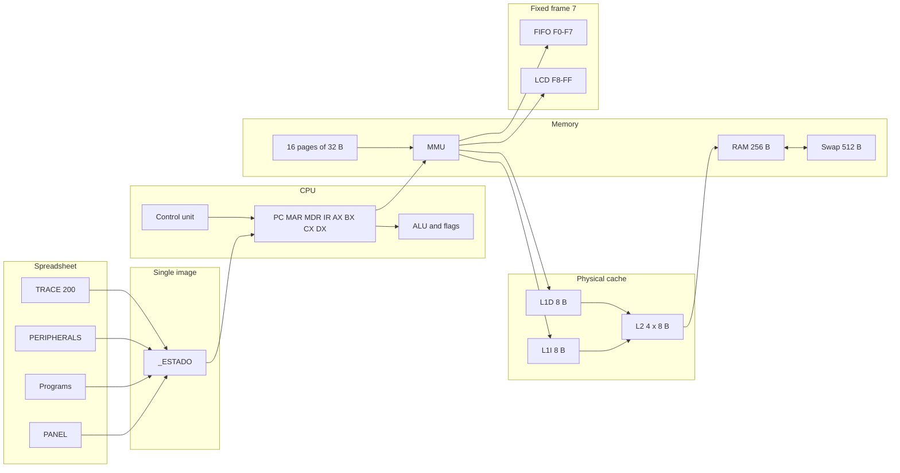
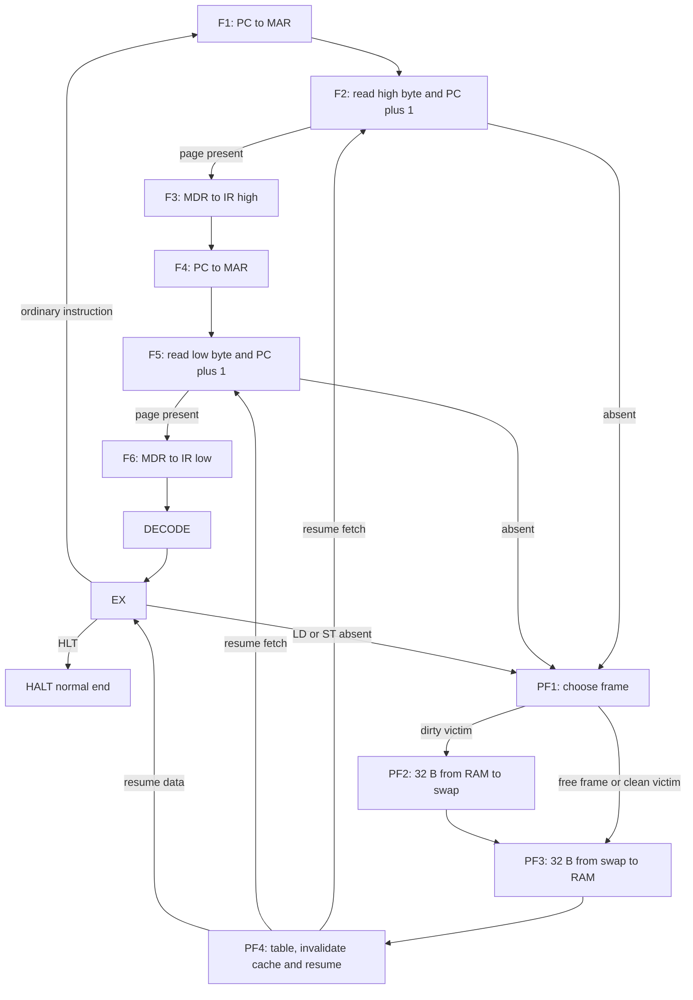
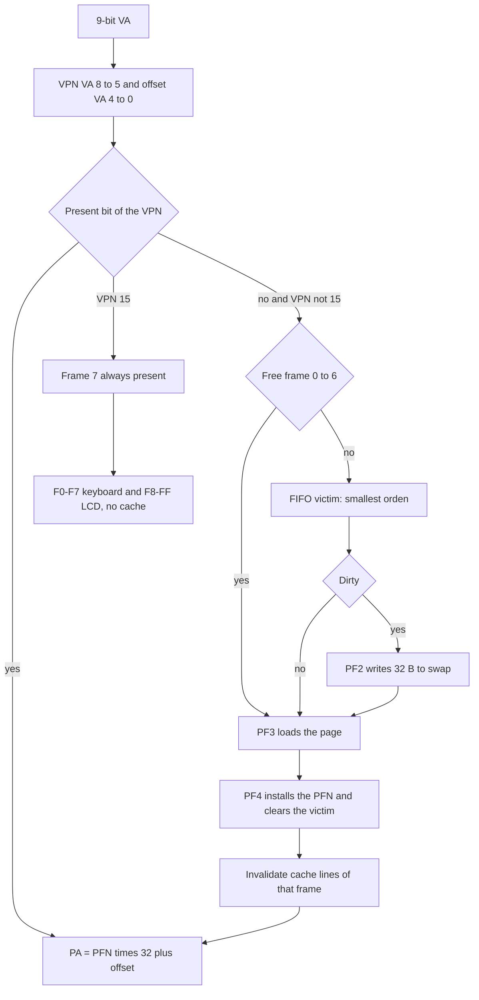
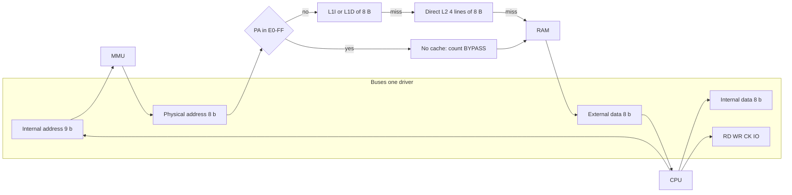
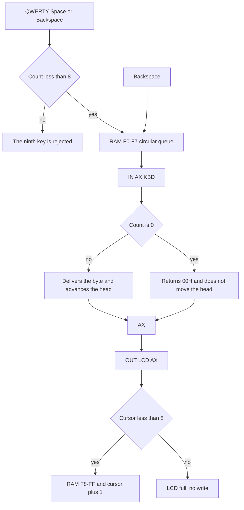

# Advanced computer architecture simulator

[Español](README.md) | [English](README_EN.md)

**Course:** Computer Architecture (SIS-131), Universidad Católica Boliviana "San Pablo", Santa Cruz Regional Academic Unit.
**Instructor:** Ing. Paulo César Loayza Carrasco.
**Term:** 2/2026.
**Repository:** [alainflores-T/Proyecto-SimuladorCPU-I00](https://github.com/alainflores-T/Proyecto-SimuladorCPU-I00).
**Team:** Alain Anthony Flores Tapia ([alainflores-T](https://github.com/alainflores-T)), Juan ([Gunter310](https://github.com/Gunter310)) and Chry ([ChryzzMT](https://github.com/ChryzzMT)).

The official team name and logo appear on the simulator spreadsheet (issue #12). They are not stored as text in this repository. If a cover page must quote them, take them from that sheet.

Validated Google Sheets copy (main interface). The engine documented here is the `develop` branch, aligned with tip `9ab18d4` of `cursor/visual-lab-9a2-a0e8`. The HTML dialog is auxiliary. The original spreadsheets are left untouched.

**Spreadsheet:** <https://docs.google.com/spreadsheets/d/1CKb2nxVO2tstUjwY1s5clJ1ME9Di0lNIpk8voLzeS20/edit>

**Apps Script project of that copy:** `1yTRwU6iB3LEfVmbfgtJ4zxun26nDwDUNQB5t3nJ_WPCnoJQD6WwEQvzD`.

This file describes that copy and the `src/` tree on `develop`. Longer notes remain in Spanish: [docs/arquitectura.md](docs/arquitectura.md), [docs/ISA.md](docs/ISA.md), [docs/control-word.md](docs/control-word.md), [docs/manual.md](docs/manual.md), [docs/program-traces.md](docs/program-traces.md), [docs/matriz.md](docs/matriz.md) and [docs/GUIA_DEFENSA.md](docs/GUIA_DEFENSA.md). Every section required by the rubric is covered below in English.

## 1. What it runs

Fixed 2-byte ISA. Fetch always reads both bytes. Registers: PC, MAR, MDR, IR, AX, BX, CX and DX. Flags: ZF, CF and SF. Physical RAM is 256 bytes (8 frames of 32), the virtual space is 512 bytes (16 pages of 32) and swap is 512 bytes. Frames 0 through 6 are pageable. Frame 7 belongs to VPN 15, is always present and is never replaced: the keyboard lives at `F0`–`F7` and the LCD at `F8`–`FF`. Cache is L1I (8 bytes), L1D (8 bytes) and a direct-mapped L2 of 4 lines of 8, with physical tags. One driver per bus; two drivers set the phase to `ERROR`.

`STEP` advances one micro-step, not one instruction. `HLT` is a normal end. A page fault is the normal path when the VPN is not in RAM (phases PF1 through PF4). It is not the `ERROR` phase.

The machine image lives on the hidden `_ESTADO` sheet. PANEL, Programas, PERIFERICOS and TRACE read or write that image. There is no second RAM. The `Laboratorio.html` dialog requests the same state through `simLabPaso` and `simLabEstado`.

## 2. Architecture

Source: [docs/diagramas/arquitectura.mmd](docs/diagramas/arquitectura.mmd).



## 3. Instruction cycle

Each call to `simMicroPaso` runs the current phase and leaves the next one. Fetch reads two bytes: the high byte in F2 and the low byte in F5. PC increments on each of those reads. Decode does not move registers. Execute depends on the opcode. `HLT` moves to `HALT` and stays there.

If the VPN is not present, that step is recorded as PF1 and a frame is chosen. A dirty victim goes through PF2 (32-byte write-back to swap) before PF3 (32-byte load from swap). PF4 updates the page table, invalidates cache lines for that frame and resumes F2, F5 or EX, depending on where the access was cut.

Source: [docs/diagramas/ciclo.mmd](docs/diagramas/ciclo.mmd).



## 4. Virtual memory, frame table and page faults

A virtual address is 9 bits wide. The VPN is bits 8 through 5 and the offset is bits 4 through 0. The physical address is `PFN * 32 + offset` (8 bits). There are 16 virtual pages. Frames 0 through 6 can be replaced. Frame 7 belongs to VPN 15, is always present and cannot be a victim. A fault requested on VPN 15 ends in `ERROR`.

The policy stored with the programs is FIFO: the page with the smallest `orden` is evicted. The code can also choose by `uso` when the policy is `LRU`. That policy is not the one used by P1, P2 or P3, and it was not measured on the sheet.

The measured P3 run had 11 faults, in this VPN order: 0, 2, 5, 9, 14, 3, 7, 11, 0, 12, 4. The first seven fill frames 0 through 6. The next four replace. The only write-back was dirty VPN 9 leaving frame 3 when VPN 4 came in. The "Last fault" label stays on the last event. It does not mean the CPU is still faulting: P3 ends in `HLT`.

Source: [docs/diagramas/paginacion.mmd](docs/diagramas/paginacion.mmd).



### Memory map

| Region | Range | Size | Notes |
| --- | --- | --- | --- |
| Virtual space | `000`–`1FF` | 512 B | 16 pages of 32 B. VA = VPN (bits 8–5) + offset (bits 4–0). |
| Physical RAM | `00`–`FF` | 256 B | 8 frames of 32 B. |
| Pageable frames | 0–6 | 224 B | The only frames eligible for FIFO replacement. |
| Frame 7 (VPN 15) | `E0`–`FF` | 32 B | Always present. Never a victim. Physical addresses `E0`–`FF` skip the cache (`BYPASS`). |
| Keyboard queue | `F0`–`F7` | 8 B | Circular FIFO in frame 7. |
| LCD buffer | `F8`–`FF` | 8 B | Eight characters. A ninth `OUT` does not write. |
| Swap | 16 pages of 32 B | 512 B | Backing store for virtual pages. |

`LD`, `ST`, jumps and `DB` reject the virtual window `1E0`–`1FF` (I/O of VPN 15). The keyboard and LCD are reached with `IN` and `OUT`.

## 5. L1I / L1D / L2 cache and buses

There are four data or address buses plus the RD, WR, CK and IO lines. Each bus has one driver (a tri-state buffer; everyone else stays High-Z). If two components try to write, the step enters `ERROR` and the destination is not updated.

L1I and L1D each hold one 8-byte line. L2 is direct-mapped, index `(PA >> 3) & 3`, physical tag `PA >> 5`. It is consulted after the MMU. Writes are write-through with write-allocate on a miss. A line has no dirty bit. A write hit in L1D updates RAM and, if the matching L2 line is present, that byte too. That maintenance increments `mant` and does not enter the L2 rate. L2 only counts demand that arrives because of an L1 miss.

Physical addresses `E0`–`FF` do not consult the cache. When a frame is replaced, lines whose base falls in those 32 bytes are invalidated.

On the measured P3 run: L1I 19 hits and 3 misses (86.4%), L1D 0 hits and 9 misses (5 from `LD` and 4 from `ST`), L2 0 hits and 12 misses. 3 + 9 = 12.

Source: [docs/diagramas/cache-buses.mmd](docs/diagramas/cache-buses.mmd).



## 6. I/O peripherals

The keyboard queue is a circular 8-byte buffer at `F0`–`F7`, with head, tail and count. Backspace moves the tail back and writes 0 to that byte. `IN reg, [KBD]` reads the head. If the count is 0, the destination register receives `00` and the head does not move: it does not wait for a key. `OUT [LCD], reg` writes at `F8` plus the cursor, up to 8 characters. A ninth `OUT` does not advance. Neither path goes through L1 or L2.

The PERIFERICOS sheet has QWERTY, Space and Backspace rows. Each key is a cell. A ninth key does not enter.

Source: [docs/diagramas/es.mmd](docs/diagramas/es.mmd).



## 7. ISA

Every instruction is 2 bytes.

Byte 0: a 5-bit opcode in bits 7 through 3, the destination register in bits 2 and 1, and address bit 8 in bit 0.
Byte 1: an immediate, the low address byte, or the source register in the two low bits.

`b0 = (opcode << 3) | (register << 1) | A8`. Registers: AX 0, BX 1, CX 2, DX 3.

| Mnemonic | Opcode | Form | Bytes | Flags | Description |
| --- | --- | --- | --- | --- | --- |
| NOP | 0 | `NOP` | 2 | no | No operation. |
| HLT | 1 | `HLT` | 2 | no | Normal end. The phase becomes `HALT`. Encoded as `08 00`. |
| MOV immediate | 2 | `MOV reg, imm` | 2 | no | Load an immediate. |
| MOV register | 3 | `MOV reg, reg` | 2 | no | Copy between registers. |
| LD | 4 | `LD reg, [addr]` | 2 | no | Load from virtual memory (through the MMU and L1D). |
| ST | 5 | `ST [addr], reg` | 2 | no | Store to virtual memory (through the MMU and L1D). |
| ADD immediate | 6 | `ADD reg, imm` | 2 | ZF, CF, SF | Add immediate. |
| ADD register | 7 | `ADD reg, reg` | 2 | ZF, CF, SF | Add register. |
| SUB immediate | 8 | `SUB reg, imm` | 2 | ZF, CF, SF | Subtract immediate. |
| SUB register | 9 | `SUB reg, reg` | 2 | ZF, CF, SF | Subtract register. |
| AND immediate | 10 | `AND reg, imm` | 2 | ZF, SF. CF unchanged | AND with immediate. |
| AND register | 11 | `AND reg, reg` | 2 | ZF, SF. CF unchanged | AND with register. |
| OR immediate | 12 | `OR reg, imm` | 2 | ZF, SF. CF unchanged | OR with immediate. |
| OR register | 13 | `OR reg, reg` | 2 | ZF, SF. CF unchanged | OR with register. |
| CMP immediate | 14 | `CMP reg, imm` | 2 | ZF, CF, SF. Does not write the register | Compare with immediate. |
| CMP register | 15 | `CMP reg, reg` | 2 | ZF, CF, SF. Does not write the register | Compare with register. |
| INC | 16 | `INC reg` | 2 | ZF, CF, SF | Increment. |
| DEC | 17 | `DEC reg` | 2 | ZF, CF, SF | Decrement. |
| JMP | 18 | `JMP addr` | 2 | no | Unconditional jump. |
| JZ | 19 | `JZ addr` | 2 | no | Jump if ZF = 1. |
| JNZ | 20 | `JNZ addr` | 2 | no | Jump if ZF = 0. |
| JC | 21 | `JC addr` | 2 | no | Jump if CF = 1. |
| IN | 22 | `IN reg, [KBD]` | 2 | no | Read the keyboard queue. |
| OUT | 23 | `OUT [LCD], reg` | 2 | no | Write one character to the LCD. |

There is no `JS`. CF after a subtraction is 1 if the result was negative before it was truncated to 8 bits. SF is bit 7 of the result. ZF is a zero result. MOV does not touch the flags.

Measured example from the P3 listing: `LD AX, [40H]` assembles to `20 40`. Opcode 4, register 0 and address `040` give high byte `20` and low byte `40`. `HLT` is `08 00`, which is the IR value `0800` at the end of P3.

## 8. Control word

Each micro-step publishes 28 signals, in this order, each 0 or 1. The panel concatenates them with no spaces. The leftmost bit is `En_PC`.

`En_PC`, `Ld_MAR`, `Mem_R`, `Mem_W`, `Ld_MDR`, `En_MDR`, `Ld_IRH`, `Ld_IRL`, `En_ALU`, `Ld_ALU`, `Ld_AX`, `En_AX`, `Ld_BX`, `En_BX`, `Ld_CX`, `En_CX`, `Ld_DX`, `En_DX`, `Ld_PC`, `En_IR`, `En_MAR`, `INC_PC`, `IO`, `En_KBD`, `Ld_LCD`, `ALU2`, `ALU1`, `ALU0`.

`En_` drives the component's value onto the bus. `Ld_` loads into the component whatever is on the bus.

| Phase | Signals |
| --- | --- |
| F1 and F4 | `En_PC`, `Ld_MAR`. The internal address comes from PC. |
| F2 and F5 | `Mem_R`, `En_MAR`, `Ld_MDR`, `INC_PC`. PC increments. |
| F3 | `En_MDR`, `Ld_IRH`. |
| F6 | `En_MDR`, `Ld_IRL`. |
| DECODE | No transfer. Publishes the instruction text. |

In Execute the signals depend on the operation. The ALU uses `ALU2`, `ALU1` and `ALU0` with this encoding: MOV 0, ADD 1, SUB 2, AND 3, OR 4, CMP 5, INC 6, DEC 7. CMP turns the ALU on and does not load the destination register. `IN` turns on `IO`, `Mem_R` and `En_KBD`. `OUT` turns on `IO`, `Mem_W` and `Ld_LCD`.

## 9. User manual

No web app is required. The manifest has only these two scopes:

- `https://www.googleapis.com/auth/spreadsheets.currentonly`
- `https://www.googleapis.com/auth/script.container.ui`

### Files in the copy's project

Paste these ten files into the copy's Apps Script project, using the same names:

| File | Role |
| --- | --- |
| `Estado.gs` | Single image: registers, RAM, swap, table, cache, trace. |
| `Cache.gs` | L1I, L1D and L2. |
| `Memoria.gs` | Translation, FIFO and page faults. |
| `ES.gs` | 8-byte queue and 8-byte LCD. |
| `CPU.gs` | One micro-step per call. |
| `Ensamblador.gs` | P1, P2 and P3 catalog, plus the assembler. |
| `Main.gs` | Menu, panel, keyboard and dialog. |
| `Pruebas.gs` | Twenty test cases. |
| `Laboratorio.html` | Auxiliary dialog. |
| `appsscript.json` | Time zone `America/La_Paz` and the two scopes above. |

### First-time setup

1. Open Extensions, Apps Script, on the copy. Do not use an original spreadsheet's project.
2. Replace or create the ten files. Save.
3. In the editor choose `simPrepararEstaCopia` and click Run. Accept the spreadsheet consent and, if it appears, the container-UI consent.
4. If the Programas editor does not match the program already in the CPU, run `simAlinearEditorAlEstado`. Do not use Load for that.
5. Reload the spreadsheet. The Simulador menu appears when it opens.
6. The lab opens from Simulador, Laboratorio visual. It is not a web page.

`simPrepararEstaCopia` redraws PANEL, PERIFERICOS and TRACE. If `_ESTADO` already has the `SIM-ESTADO-v1` mark, it does not wipe the image.

### Controls

The interface is the [linked spreadsheet](https://docs.google.com/spreadsheets/d/1CKb2nxVO2tstUjwY1s5clJ1ME9Di0lNIpk8voLzeS20/edit): registers and ALU on the left, a 16×16 RAM on the right, and below that the cache, virtual memory and frame table. In a 1280 px-wide window about 750 px are useful; the rest needs scrolling. There is no HEX/DEC/BIN switch.

| Control | Effect |
| --- | --- |
| STEP | One micro-step. Not a full instruction. |
| RUN | Several micro-steps, in batches, until `HLT`, `ERROR`, pause or the time cap. |
| LOAD | Loads the demo chosen in Cargar. Replaces the CPU image and copies that demo into the editor and the listing. |
| PAUSE | Sets the pause flag on the sheet. Sheet Stop during a long Run was not validated. |
| RESET | Returns to F1 with PC 0 and keeps the program and swap. |
| Cargar | Only selects P1, P2 or P3. Nothing is loaded until LOAD. |
| En CPU | Shows the program stored in `_ESTADO`. |
| DELAY | HTML dialog pause, in milliseconds. |

The menu repeats Step, Run, Stop, Reset, Cargar selector, Align editor to the program in the CPU, Assemble, Load editor, Type, Clear queue, Edit memory, Run in-memory tests and Visual lab.

**Load editor** assembles whatever is written in Programas and puts it in swap. That is not the same as LOAD of a catalog demo.

### How to load a catalog program

1. On the panel, choose P1, P2 or P3 in Cargar.
2. Click LOAD. That replaces the CPU image and aligns the editor and the listing.
3. For P2, open PERIFERICOS and type `HOLA` **before** Run.
4. Click STEP (one micro-step) or RUN (until `HLT`).
5. Read registers, flags, TRACE, HIT/MISS and, when it applies, the queue and the LCD.

`SIM_TRAZA_MAX` is 200. The TRACE sheet shows those rows. The panel shows the last 12.

## 10. Catalog programs

The three demos live in `simCatalogo()` in `src/Ensamblador.gs`. LOAD copies that text into the editor, assembles it into swap and leaves PC at the first instruction. Figures were read from the copy after Load and Run, and kept after `9ab18d4` for P3. Twenty local tests and the same twenty on Google: 0 failures.

### P1. Arithmetic AX BX CX DX

Computes `AX = BX * CX` by adding DX (a copy of BX) as many times as CX says.

```
MOV AX, 00H
MOV BX, 04H
MOV CX, 03H
MOV DX, BX
loop:
ADD AX, DX
DEC CX
JNZ loop
HLT
```

1. `MOV AX, 00H` clears the accumulator.
2. `MOV BX, 04H` and `MOV CX, 03H` load the factors 4 and 3.
3. `MOV DX, BX` keeps a copy of 4 in DX. BX is not touched again, so the original factor is still readable at the end.
4. The `loop` does `AX ← AX + DX` and `CX ← CX - 1`. While CX is not zero, `JNZ loop` goes back to the label.

| Pass | Before: AX, CX | ADD AX, DX | DEC CX | JNZ taken? |
| --- | --- | --- | --- | --- |
| 1 | 00, 03 | AX = 04 | CX = 02 | yes |
| 2 | 04, 02 | AX = 08 | CX = 01 | yes |
| 3 | 08, 01 | AX = 0C | CX = 00, ZF = 1 | no |

5. `HLT` ends the run. There are eight 2-byte instructions, so PC is `010`. Measured result: AX `0C` (12, which is 4 times 3), BX `04`, CX `00`, DX `04`, ZF 1. L1I: 26 hits and 2 misses.

### P2. Keyboard to LCD echo

Copies eight bytes from the keyboard to the LCD. An empty queue does not wait: it returns `00` and does not move the head. That is why `HOLA` is typed on PERIFERICOS **before** Run.

```
MOV CX, 08H
echo:
IN AX, [KBD]
OUT [LCD], AX
DEC CX
JNZ echo
HLT
```

1. `MOV CX, 08H` sets eight rounds.
2. Each round, `IN AX, [KBD]` pops one byte from the circular queue at `F0`–`F7` and `OUT [LCD], AX` writes it at `F8` plus the cursor.
3. `DEC CX` and `JNZ echo` repeat until CX reaches 0.

If H, O, L and A are pressed first, the queue shows 72, 79, 76 and 65 (those letters in ASCII) and the count is 4.

| Round | IN reads | OUT writes on the LCD |
| --- | --- | --- |
| 1 to 4 | 48H, 4FH, 4CH, 41H (H O L A) | `48 4F 4C 41` |
| 5 to 8 | `00` (empty queue, head does not move) | four zeros |

At the end the queue is empty and the LCD is `48 4F 4C 41 00 00 00 00`. A ninth character would not have entered the queue or the LCD. Backspace, if used before Run, removes the last key that has not been read yet.

### P3. Scattered accesses

Walks nine different pages without using VPN 15 (the I/O window, `1E0H`–`1FFH`). The code sits in page 0. Data is planted with `ORG` / `DB`, and some addresses are later overwritten by `ST`. Only 7 frames are pageable, so FIFO eventually evicts pages (including the code) and write-back happens if the victim is dirty.

```
LD AX, [40H]
LD BX, [A0H]
ADD AX, BX
ST [120H], AX
ST [1C0H], BX
LD CX, [60H]
ST [E0H], CX
LD DX, [160H]
ST [180H], DX
LD AX, [80H]
HLT
```

Initial data (virtual address → VPN → value):

| Address | VPN (`addr >> 5`) | Initial value | What the program does |
| --- | --- | --- | --- |
| `40H` | 2 | `01H` | `LD AX` reads 01. |
| `A0H` | 5 | `02H` | `LD BX` reads 02. |
| `60H` | 3 | `03H` | `LD CX` reads 03. |
| `80H` | 4 | `0AH` | The last `LD AX` leaves AX at `0A` and hides the sum. |
| `E0H` | 7 | `05H` | `ST CX` writes 03. This is virtual page 7, not the I/O window `1E0H`–`1FFH`. |
| `120H` | 9 | `06H` | `ST AX` writes the sum 03. This page becomes dirty. |
| `160H` | 11 | `04H` | `LD DX` reads 04. |
| `180H` | 12 | `09H` | `ST DX` writes 04. |
| `1C0H` | 14 | `07H` | `ST BX` writes 02. |

Walkthrough:

1. `LD AX, [40H]` sets AX = 01. `LD BX, [A0H]` sets BX = 02.
2. `ADD AX, BX` leaves AX = 03. That sum is not AX's final value.
3. `ST [120H], AX` stores 03 in VPN 9 (the page becomes dirty). `ST [1C0H], BX` stores 02 in VPN 14.
4. `LD CX, [60H]` sets CX = 03. `ST [E0H], CX` stores 03 in VPN 7.
5. `LD DX, [160H]` sets DX = 04. `ST [180H], DX` stores 04 in VPN 12.
6. `LD AX, [80H]` sets AX = 0A. That is why AX is not 03 at the end.
7. `HLT` occupies `014H`–`015H`. Fetch already added both bytes, so PC is `016`, MAR is `015` and IR is `0800` (`08 00` is HLT).

Measured page faults, in VPN order: 0, 2, 5, 9, 14, 3, 7, 11, 0, 12, 4. The first seven fill frames 0 through 6 (code in VPN 0 and data in 2, 5, 9, 14, 3 and 7). The next four replace. The repeated 0 is the code: FIFO evicted it and it had to be brought back. The only write-back was dirty VPN 9 leaving frame 3 when VPN 4 came in (`LD AX, [80H]`).

Measured result: `HLT`, PC `016`, AX `0A`, BX `02`, CX `03`, DX `04`, MAR `015`, IR `0800`, flags 0. 141 micro-steps. Cache: L1I 19 hits and 3 misses (86.4%), L1D 0 hits and 9 misses (5 loads and 4 stores), L2 0 hits and 12 misses.

Details and limits: [docs/program-traces.md](docs/program-traces.md) and [docs/matriz.md](docs/matriz.md) (Spanish). Oral defense notes: [docs/GUIA_DEFENSA.md](docs/GUIA_DEFENSA.md) (Spanish).

## 11. Gitflow and Kanban

Work is split into repository issues and tracked on the [GitHub Project board](https://github.com/users/alainflores-T/projects/4) (Backlog, To Do, In Progress, In Review, Done).

- `main` holds the stable version.
- `develop` is the integration branch.
- Each issue is developed on a personal branch `feature/<github-username>/<n>-slug`, for example `feature/alainflores-T/16-cpu-cycle`.
- Commits are frequent and semantic (`feat`, `fix`, …) and mention the issue.
- Changes reach `develop` through a Pull Request reviewed by another teammate. The body includes `Closes #N` when the issue is complete.
- Nobody works directly on `main`. `main` receives `develop` at the end.

Alain (CPU, buses, control word and documentation integration), Juan (virtual memory, paging and cache) and Chry (I/O, visual identity and programs) open branches under their own usernames so the commit graph shows each person's work.

## 12. Limits that matter

- Sheet Stop during a Run is not validated. Pause, resume and Reset were tested in the HTML lab and stayed still for 5 seconds. That is a different control.
- The stored trace is 200 micro-steps (`SIM_TRAZA_MAX` in `Estado.gs`). It is not 80. The panel shows the last 12.
- The native panel uses about 750 px of a 1280 px width, and virtual memory needs scrolling. It does not reproduce the HTML dialog.
- There is no HEX/DEC/BIN switch.
- People using the copy removed protections by hand. `simPrepararEstaCopia` can put them back. Sharing the file is not that protection: everyone sees the same CPU.
- The source does not claim a full memory-and-cache mark. There are 8 physical frames and only 7 are pageable.

## More

- [Install and use](docs/manual.md) (Spanish)
- [Architecture](docs/arquitectura.md) (Spanish)
- [ISA](docs/ISA.md) (Spanish)
- [Control word](docs/control-word.md) (Spanish)
- [P1, P2 and P3 results](docs/program-traces.md) (Spanish)
- [Evidence and limits](docs/matriz.md) (Spanish)
- [Defense guide](docs/GUIA_DEFENSA.md) (Spanish)
- Loose diagrams: [docs/diagramas](docs/diagramas)
