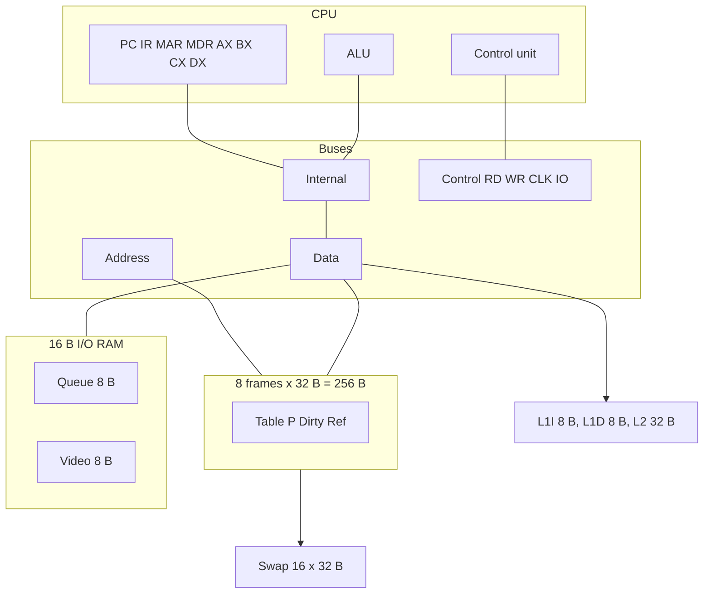

# CPU Simulator — Computer Architecture (SIS-131)

Universidad Católica Boliviana San Pablo. Instructor: Ing. Paulo César Loayza Carrasco.

Single-core, single-process, single-thread CPU. Registers AX, BX, CX, DX, PC, IR, MAR and MDR. Flags ZF, CF and SF.

| Member | GitHub | Modules already merged into `develop` |
| --- | --- | --- |
| Alain Flores | [@alainflores-T](https://github.com/alainflores-T) | CPU, buses, tri-state buffers, control word, ISA |
| Juan Escalante | [@Gunter310](https://github.com/Gunter310) | Frames, swap, MMU, replacement, cache |
| Chry | [@ChryzzMT](https://github.com/ChryzzMT) | Catalog, editor, assembler, loader, keyboard, LCD, UI |

**Official team name and logo:** still pending the team's agreement (issue [#12](https://github.com/alainflores-T/Proyecto-SimuladorCPU-I00/issues/12)). This branch does not invent either one.

**Reference spreadsheet (not modified by this branch):** [Ciclodeinstruccion](https://docs.google.com/spreadsheets/d/1RnR5stD-B3N6SorOEXixn78WR9USc9oh7loojdVo1MI/edit?usp=sharing)

Deploy the script into a **copy**. Steps: [`docs/despliegue-copia.md`](docs/despliegue-copia.md). The Spanish manual is [`README.md`](README.md).

## Architecture



Control word and HEX: [`docs/control-word.md`](docs/control-word.md). ISA: [`docs/ISA.md`](docs/ISA.md). Why I/O does not consume a frame: [`docs/decision-es-vm.md`](docs/decision-es-vm.md).

An undriven bus shows `ZZ`. If two devices have `En=1` on the same bus, `transfer` does not write the destination, sets `HALT` and throws. `recuperarContencion` returns to `READY` with the buses released.

## Memory and cache

- Physical memory is 256 B: frames 0–7, 32 B each. Only frames 0–6 hold pages.
- Frame 7 is I/O inside that RAM: F0H–F7H keyboard, F8H–FFH LCD. E0H–EFH is the unused rest of the same frame, not a second memory.
- Virtual space is 512 B, pages 0–15. Translation never targets frame 7.
- When the 7 eligible frames are full, FIFO or LRU picks a victim among them. A dirty victim is written back. F0H–FFH are not overwritten by paging.
- LOAD selects **FIFO** and shows it on the Reemplazo sheet. `usarLRU` switches the policy.
- L1I and L1D: one 8-byte line each. L2: four 8-byte lines, direct-mapped. Write-through. L2 is counted only when L1 misses. `FETCH_3` reuses the bytes `FETCH_2` already read.

## I/O

`IN reg, [KBD]` and `OUT [LCD], reg` drive the data bus and the cells F0H–FFH. They run together with a paged program. An empty `IN` returns `00H` and does not advance the queue.

## Controls

| Control | Effect |
| --- | --- |
| LOAD | Assembles `Directory!B1`, writes swap, selects FIFO, marks every page absent |
| STEP | One micro-step, unless a RUN token is active |
| RUN | Batches of 16 micro-steps. The sidebar asks for the next batch. The server does not loop until `HALT` |
| PAUSE | The next batch executes no steps. A menu click cannot interrupt a call that has not returned |
| RESET | PC, IR, MAR, MDR, AX–DX, flags and buses back to READY. Frames, swap, cache and I/O stay |
| CLEAR | Empties physical RAM and page presence. Keeps the last LOAD's swap, including write-backs already stored there |

`onOpen` only installs menus. `prepararSimulador` creates missing sheets and refuses a foreign sheet that is not empty.

The sidebar (`src/Panel.html`) renders `uiSnapshot`: registers, ALU, buses, counters, resident pages, queue and LCD. Hit and miss colors come from cache events, not from a decoration timer.

## Programs

Eight sources live in `programs/` and in the catalog. The three required demos:

1. `arithmetic-ax-dx.asm` — AX = BX × CX by repeated addition.
2. `keyboard-lcd-echo.asm` — eight characters from the queue to the LCD.
3. `scattered-access.asm` — nine pages, dirty stores, faults and misses.

Predicted traces and the mock measurements: [`docs/program-traces.md`](docs/program-traces.md).

## Automated test

```bash
node tests/run-motor.js
```

It loads the `src/*.gs` engine against an in-memory workbook. It covers syntax, the three programs through `loadSelectedProgram` and `uiLoteRun`, bus contention, pause, reset, clear, FIFO, faults, write-back and the IN/OUT control-word HEX. It does not open the Google spreadsheet.

## Short manual

1. Prepare sheets.
2. Initialize the catalog and select a program.
3. LOAD.
4. For the echo, enqueue eight bytes before RUN.
5. Open the sidebar and press RUN. PAUSE applies on the next batch. RESET repeats with resident memory. CLEAR forces page faults again against the same swap.
