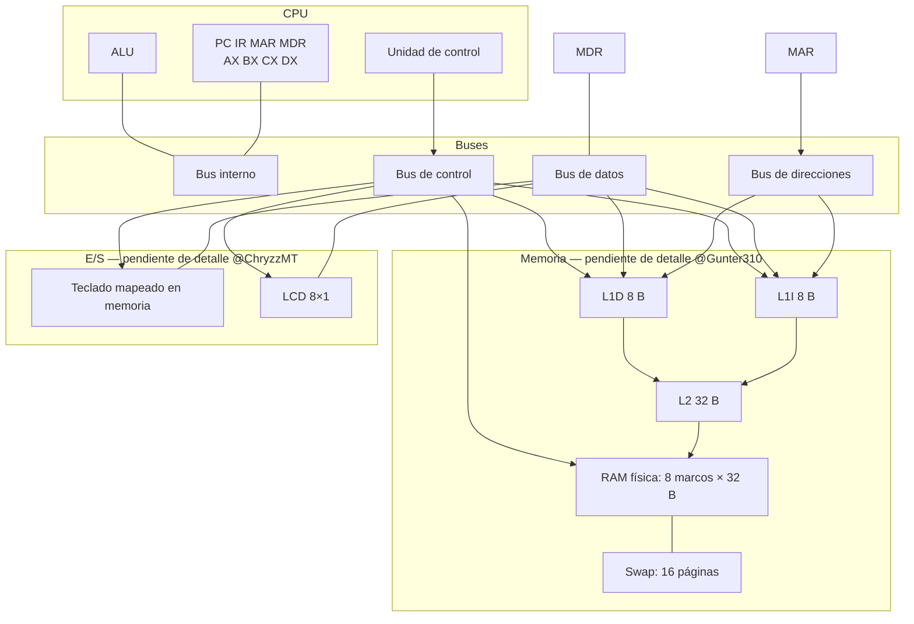
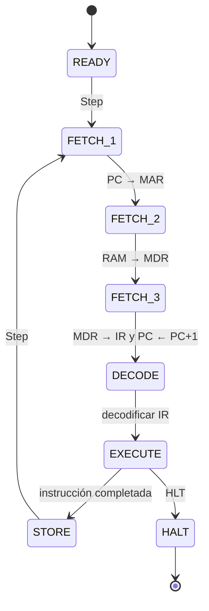
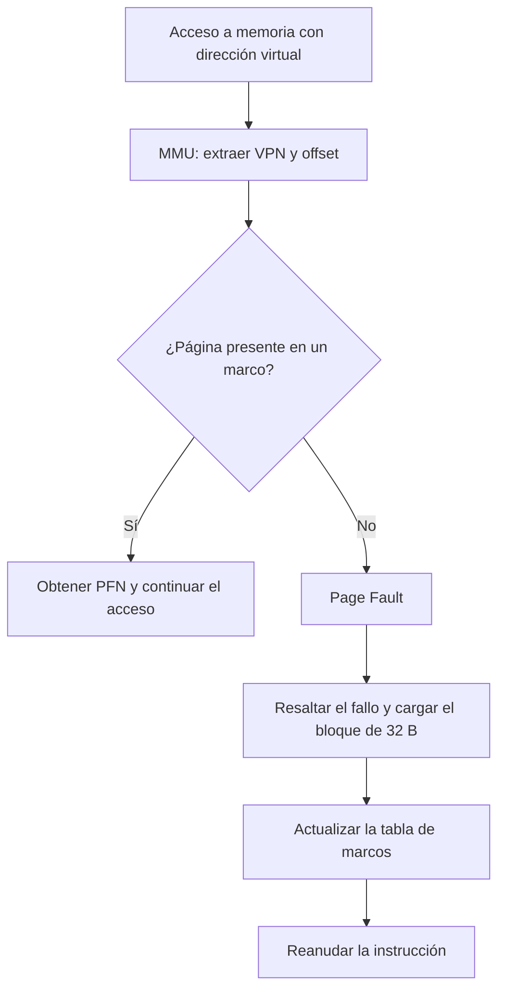
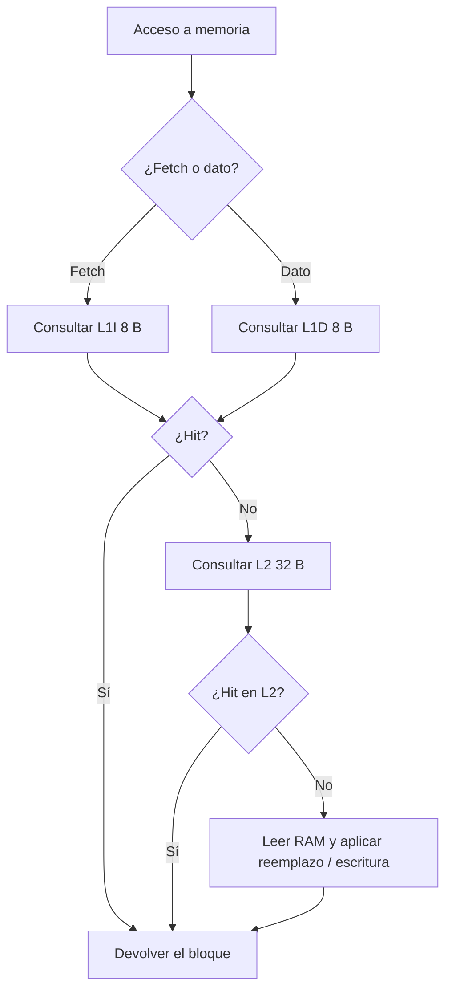
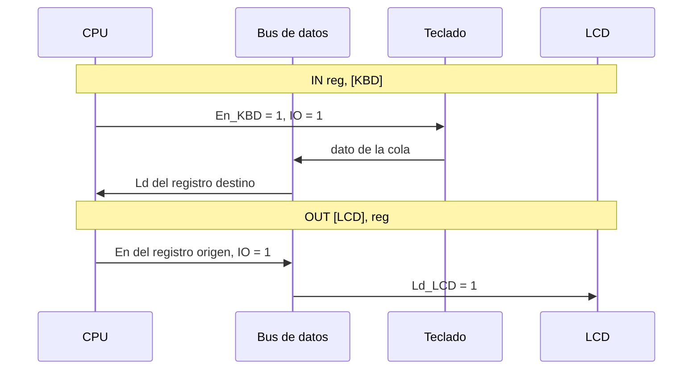

# Simulador de CPU de un núcleo

Documentación técnica en español del proyecto de **Arquitectura de Computadoras (SIS-131)**, Universidad Católica Boliviana. Criterio G6 de la rúbrica.

> **Estado de este documento.** Esta es una primera versión integrable. Las secciones de CPU, buses, ISA, palabra de control, ciclo de instrucción y metodología están listas. Faltan el detalle de caché y memoria virtual (Juan / [@Gunter310](https://github.com/Gunter310)), el de I/O, catálogo, editor y la identidad visual del equipo (Chry / [@ChryzzMT](https://github.com/ChryzzMT)). Esos huecos están marcados como *Pendiente*. El issue [#36](https://github.com/alainflores-T/Proyecto-SimuladorCPU-I00/issues/36) se cierra cuando esas partes estén incorporadas.

**Nombre del equipo y logo:** *Pendiente del issue [#12](https://github.com/alainflores-T/Proyecto-SimuladorCPU-I00/issues/12) (Chry).*

**Materia:** Arquitectura de Computadoras · SIS-131 · UCB
**Profesor:** *Paolo Cesar Loayza*

| Integrante | GitHub | Módulos |
| --- | --- | --- |
| Alain Flores | [@alainflores-T](https://github.com/alainflores-T) | CPU, buses, buffers tri-estado, palabra de control, ISA, documentación |
| Juan Escalante | [@Gunter310](https://github.com/Gunter310) | Memoria virtual (MMU, marcos, fallos de página) y jerarquía de caché |
| Chry | [@ChryzzMT](https://github.com/ChryzzMT) | Catálogo de programas, ensamblador, I/O (teclado y LCD) e interfaz |

**Hoja de cálculo (simulador en Google Sheets):** [abrir la hoja](https://docs.google.com/spreadsheets/d/1RnR5stD-B3N6SorOEXixn78WR9USc9oh7loojdVo1MI/edit?usp=sharing)

El enlace debe abrirse con permiso de **lectura para cualquiera que tenga el vínculo**. Conviene comprobarlo en una ventana de incógnito (sin sesión del equipo).

El código fuente de Apps Script está versionado en [`src/`](src/). La referencia de la Parte 1 está en `ciclodeinstruccion.xlsx`.

---

## Arquitectura general

CPU de un núcleo, un proceso y un hilo, con cuatro registros de propósito general (`AX`, `BX`, `CX`, `DX`), registros de sistema (`PC`, `IR`, `MAR`, `MDR`), ALU y banderas `ZF`, `CF` y `SF`.

La unidad de control emite una **palabra de control** en cada micro-paso. Esa palabra enciende los buffers tri-estado (`En_*` publica un valor en el bus, `Ld_*` carga un registro) y las líneas `Mem_R`, `Mem_W`, `INC_PC` e `IO`.

Hay un bus **interno** (entre ALU y registros) y buses **externos** de dirección, datos y control. El bus de datos queda en alta impedancia (`ZZ`) cuando nadie lo conduce. Dos `En=1` sobre el mismo bus se detectan como contención: el panel se pone en rojo y la CPU entra en `HALT`.

Alrededor de la CPU, el diseño de la rúbrica contempla caché L1I / L1D / L2, RAM física de 8 marcos, Swap de 16 páginas, teclado y LCD. Esos bloques los implementan Juan y Chry; en el diagrama aparecen como parte de la arquitectura objetivo.



Colores del panel de buses en la hoja: interno verde `#C8E6C9`, dirección morado `#CE93D8`, datos naranja `#FFE0B2`, control `#FFCDD2`, alta impedancia gris `#EEEEEE`.

---

## Ciclo de instrucción

Cada pulsación de **Step** avanza exactamente un micro-paso. El estado vive en la celda `B2` de Hoja 1.



Durante el FETCH:

1. **FETCH_1** — el `PC` se copia al `MAR` por el bus interno (`En_PC`, `Ld_MAR`).
2. **FETCH_2** — lectura de memoria hacia el `MDR` (`Mem_R`, `Ld_MDR`, `En_MAR` en el bus de direcciones).
3. **FETCH_3** — el `MDR` pasa al `IR` (`En_MDR`, `Ld_IR`) y después se incrementa el `PC` (`En_ALU`, `Ld_PC`, `INC_PC`).

`DECODE` interpreta el `IR`. `EXECUTE` realiza la operación (MOV, ALU, salto, LD/ST, etc.). `STORE` cierra el ciclo y el siguiente Step vuelve a `FETCH_1`. `HLT` detiene la máquina.

> **Pendiente (@Gunter310 y issue [#16](https://github.com/alainflores-T/Proyecto-SimuladorCPU-I00/issues/16)).** Cuando existan la MMU y la caché, cada acceso a memoria deberá traducir la dirección virtual, atender un posible Page Fault y consultar L1I (fetch) o L1D (datos) antes de bajar a L2 y a RAM.

### Flujo de Page Fault

*Pendiente de la descripción final de Juan (@Gunter310), issues [#24](https://github.com/alainflores-T/Proyecto-SimuladorCPU-I00/issues/24), [#25](https://github.com/alainflores-T/Proyecto-SimuladorCPU-I00/issues/25) y [#26](https://github.com/alainflores-T/Proyecto-SimuladorCPU-I00/issues/26). El diagrama siguiente es el flujo previsto por la rúbrica, no una traza medida.*



### Flujo de acceso a caché

*Pendiente de la descripción final de Juan (@Gunter310), issues [#27](https://github.com/alainflores-T/Proyecto-SimuladorCPU-I00/issues/27), [#28](https://github.com/alainflores-T/Proyecto-SimuladorCPU-I00/issues/28) y [#29](https://github.com/alainflores-T/Proyecto-SimuladorCPU-I00/issues/29).*



### Secuencia IN / OUT

*Pendiente de la descripción final de Chry (@ChryzzMT), issues [#33](https://github.com/alainflores-T/Proyecto-SimuladorCPU-I00/issues/33), [#34](https://github.com/alainflores-T/Proyecto-SimuladorCPU-I00/issues/34) y [#35](https://github.com/alainflores-T/Proyecto-SimuladorCPU-I00/issues/35). `IN` (`20`) y `OUT` (`21`) ya están reservados en la ISA.*



---

## ISA

CPU de 8 bits con registros `AX`, `BX`, `CX`, `DX` y banderas `ZF`, `CF`, `SF`. Tabla completa también en [`docs/ISA.md`](docs/ISA.md).

| Mnemónico | Formato | Opcode | Bytes | Banderas | Descripción |
| --- | --- | --- | --- | --- | --- |
| NOP | NOP | 00 | 1 | — | No opera |
| MOV | MOV reg, reg / MOV reg, imm | 01 / 11 | 3 | ZF, SF | `reg ← src` |
| ADD | ADD reg, reg / imm | 02 / 12 | 3 | ZF, CF, SF | `reg ← reg + src` |
| SUB | SUB reg, reg / imm | 03 / 13 | 3 | ZF, CF (préstamo), SF | `reg ← reg − src` |
| INC | INC reg | 04 | 2 | ZF, CF, SF | `reg ← reg + 1` |
| DEC | DEC reg | 05 | 2 | ZF, CF, SF | `reg ← reg − 1` |
| CMP | CMP reg, reg / imm | 06 / 16 | 3 | ZF, CF, SF | `reg − src` (no guarda el resultado) |
| LD | LD reg, [addr] | 07 | 3–4 | — | `MAR ← addr`; `MDR ← M[MAR]`; `reg ← MDR` |
| ST | ST [addr], reg / imm | 08 / 18 | 3–4 | — | `MAR ← addr`; `MDR ← src`; `M[MAR] ← MDR` |
| JMP | JMP addr | 09 | 2–3 | — | `PC ← addr` |
| JZ | JZ addr | 0A | 2–3 | — | Si `ZF = 1`: `PC ← addr` |
| JNZ | JNZ addr | 0B | 2–3 | — | Si `ZF = 0`: `PC ← addr` |
| JC | JC addr | 0C | 2–3 | — | Si `CF = 1`: `PC ← addr` |
| JS | JS addr | 0D | 2–3 | — | Si `SF = 1`: `PC ← addr` |
| AND | AND reg, reg / imm | 0E / 1E | 3 | ZF, SF | `reg ← reg AND src` |
| OR | OR reg, reg / imm | 0F / 1F | 3 | ZF, SF | `reg ← reg OR src` |
| IN | IN reg, [KBD] | 20 | 3 | — | `reg ←` cola del teclado *(pendiente I/O)* |
| OUT | OUT [LCD], reg | 21 | 3 | — | LCD `← reg` *(pendiente I/O)* |
| HLT | HLT | FF | 1 | — | Detiene la CPU |

**Codificación:** opcode + operandos. Se suma `10H` al opcode cuando el origen es un inmediato (no aplica a `LD`).
**Registros:** `AX = 00`, `BX = 01`, `CX = 02`, `DX = 03`. **Puertos:** `KBD = 00`, `LCD = 01`.
**Direcciones:** 9 bits, `000H`–`1FFH` (512 B). Las direcciones por encima de `FFH` ocupan 2 bytes.

---

## Palabra de control

Vector de 23 bits que la unidad de control emite en cada micro-paso. El bit más significativo es `En_PC`. El valor se muestra en hexadecimal de 6 dígitos con sufijo `H`.

Orden de los bits:

`En_PC`, `Ld_MAR`, `Mem_R`, `Mem_W`, `Ld_MDR`, `En_MDR`, `Ld_IR`, `En_ALU`, `Ld_AX`, `En_AX`, `Ld_BX`, `En_BX`, `Ld_CX`, `En_CX`, `Ld_DX`, `En_DX`, `Ld_PC`, `En_IR`, `En_MAR`, `INC_PC`, `IO`, `En_KBD`, `Ld_LCD`

En Hoja 1 el panel está a partir de `J42`: cada bit en 0/1 (verde si está activo) y el HEX correspondiente. La pestaña `Microcodigo` lista la palabra de cada micro-paso. El Historial guarda esa palabra en la columna **Palabra de Control**.

Especificación exportada: [`docs/control-word,md.txt`](docs/control-word,md.txt) (al integrar este README conviene renombrarlo a `docs/control-word.md`).

| Fase / instrucción | Descripción | Señales activas | HEX |
| --- | --- | --- | --- |
| FETCH_1 | PC → MAR | En_PC, Ld_MAR | 600000H |
| FETCH_2 | RAM → MDR (lectura) | Mem_R, Ld_MDR, En_MAR | 140010H |
| FETCH_3a | MDR → IR | En_MDR, Ld_IR | 030000H |
| FETCH_3b | PC + 1 | En_ALU, Ld_PC, INC_PC | 008048H |
| DECODE | Decodificar IR | (ninguna) | 000000H |
| MOV (reg) | Origen → destino (ej. MOV AX, BX) | En_BX, Ld_AX | 002200H |
| MOV (imm) | Inmediato IR → destino (ej. MOV AX, imm) | En_IR, Ld_AX | 002004H |
| ALU | Resultado ALU → destino (ej. AX) | En_ALU, Ld_AX | 00A000H |
| CMP | ALU publica el resultado | En_ALU | 008000H |
| JMP / Jcc tomado | Dirección IR → PC | En_IR, Ld_PC | 000014H |
| Jcc no tomado | No hay transferencia | (ninguna) | 000000H |
| LD T1 | Dirección (IR) → MAR | En_IR, Ld_MAR | 200004H |
| LD T2 | RAM → MDR | Mem_R, Ld_MDR, En_MAR | 140010H |
| LD T3 | MDR → registro (ej. AX) | En_MDR, Ld_AX | 022000H |
| ST T1 | Dirección (IR) → MAR | En_IR, Ld_MAR | 200004H |
| ST T2 | Dato (ej. AX) → MDR | En_AX, Ld_MDR | 041000H |
| ST T3 | MDR → RAM (escritura) | Mem_W, En_MDR, En_MAR | 0A0010H |
| NOP / HLT | Sin transferencias | (ninguna) | 000000H |

`En_MAR` se enciende en lecturas y escrituras porque `MAR` conduce el bus de direcciones (además de `Mem_R` o `Mem_W`). `En_KBD` y `Ld_LCD` quedan en 0 hasta que aterrice el I/O.

---

## Mapa de memoria

| Región | Tamaño | Notas |
| --- | --- | --- |
| Espacio virtual | 512 B (`000H`–`1FFH`) | Dirección de 9 bits |
| Página / marco | 32 B | `VPN = dirección >> 5`, `offset = dirección & 1FH` |
| Páginas virtuales | 16 | VPN de 4 bits (0–15) |
| RAM física | 256 B | 8 marcos de 32 B (módulo de Juan, [#22](https://github.com/alainflores-T/Proyecto-SimuladorCPU-I00/issues/22) y [#24](https://github.com/alainflores-T/Proyecto-SimuladorCPU-I00/issues/24)) |
| Swap | 16 páginas | Respaldo de las páginas virtuales (módulo de Juan) |
| Cola del teclado | 8 B | *Pendiente: dirección base a coordinar entre Chry y Juan (#33)* |
| Buffer del LCD | 8 B | *Pendiente: dirección base a coordinar entre Chry y Juan (#34)* |

Formato de la dirección virtual:

```text
15 14 13 12 11 10  9  8  7  6  5  4  3  2  1  0
             |      VPN 4 bits     | offset 5 bits |
                           dirección de 9 bits
```

---

## Manual de uso

*Las capturas del catálogo, el editor, el ensamblado y la carga las aporta Chry cuando esos paneles estén listos (#13, #17, #19, #20). Lo siguiente describe el ciclo que ya se puede operar en la hoja.*

1. Abre la [hoja de cálculo](https://docs.google.com/spreadsheets/d/1RnR5stD-B3N6SorOEXixn78WR9USc9oh7loojdVo1MI/edit?usp=sharing).
2. Pulsa **Reset**. Se limpian registros, banderas, buses, buffers y la palabra de control (`HEX 000000H`). También se crea o actualiza la pestaña `Microcodigo`.
3. Carga un programa. *Pendiente (@ChryzzMT): pasos exactos del catálogo, editor, ensamblar y Load hacia las páginas virtuales.*
4. Pulsa **Step** para avanzar un micro-paso, o **Run** para ejecutar hasta `HLT`.
5. Observa en Hoja 1:
   - Estado de la CPU en `B2` (`FETCH_1`, `FETCH_2`, `FETCH_3`, `DECODE`, `EXECUTE`, `STORE`, `HALT`).
   - Registros `PC`, `IR`, `MAR`, `MDR`, `AX`–`DX` y banderas `ZF`, `CF`, `SF`.
   - Panel de buses (alrededor de `J15`): valor y conductor del bus interno, dirección, datos, `Read`, `Write`, `Clock` e `IO`.
   - Buffers tri-estado (alrededor de `J28`): `En`, `Ld` y estado (valor en verde o `Z` en gris).
   - Palabra de control (desde `J42`): bits 0/1 y HEX.
6. Revisa la pestaña **Historial**: hora, ciclo, acción, registros, ALU, banderas y palabra de control.
7. Si dos dispositivos publican el mismo bus, el panel se pone en rojo, se registra el conflicto y la CPU pasa a `HALT`. Hay que dar Reset para continuar.

---

## Programas del catálogo

Hay tres programas previstos para la demostración. El detalle de trazas (fallos de página y Hit/Miss) está en [`docs/program-traces.md`](docs/program-traces.md); esas cifras son estimaciones a la espera de la MMU y la caché. *Chry puede ajustar nombres, textos y resultados cuando el catálogo quede cerrado.*

| Programa | Idea | Resultado o nota |
| --- | --- | --- |
| `arithmetic-ax-dx` | Aritmética y un bucle con `AX`–`DX` | Si se ejecuta el texto: `AX=0CH`, `BX=04H`, `CX=00H`, `DX=04H`, `ZF=1` |
| `keyboard-lcd-echo` | Eco de 8 transferencias teclado → LCD | Requiere `IN`/`OUT` (#33–#35); todavía no se ejecuta en la CPU |
| `scattered-access` | Lecturas y escrituras en varias páginas virtuales | Recorre más de 8 VPN distintas, así que un paginador real tendría que reemplazar un marco |

Los archivos viven en [`programs/`](programs/).

---

## Metodología

### Tablero Kanban

El seguimiento está en el [tablero del proyecto](https://github.com/users/alainflores-T/projects/4/views/1). Las columnas pedidas por el enunciado son Backlog, To Do, In Progress, In Review y Done (issue [#10](https://github.com/alainflores-T/Proyecto-SimuladorCPU-I00/issues/10)).

### Gitflow

- `main` — entregas / versión lista para la defensa.
- `develop` — integración diaria.
- Una rama por issue, desde `develop`: `feature/<github>/<n>-slug` (por ejemplo `feature/alainflores-T/32-control-word`).
- Los cambios entran a `develop` por Pull Request. Un compañero revisa. `main` solo recibe `develop` al final.
- El cuerpo del PR menciona el issue (`Closes #N` cuando el trabajo está completo).

### Commits semánticos

Formato `tipo(módulo): resumen`, por ejemplo:

- `feat(cpu): add flags ZF, CF and SF (#14)`
- `feat(cpu): add control word and microcode table (#32)`
- `docs: write Spanish README architecture and ISA (#36)`

Tipos usados: `feat`, `fix`, `docs`, `refactor`, `test`, `chore`.

### Reparto y layout del repo

| Ruta | Contenido |
| --- | --- |
| `src/` | Código Apps Script (`.gs`) versionado |
| `docs/` | ISA, palabra de control, trazas de programas |
| `programs/` | Programas en ensamblador |
| `ciclodeinstruccion.xlsx` | Referencia de la Parte 1 |

El código de la hoja se mantiene alineado copiando los archivos de `src/` al editor de Apps Script. No se trabaja directo sobre `main`.

---

## Cómo completar las partes que faltan

**Juan (@Gunter310):** un párrafo (o sección corta) de memoria virtual — tabla de marcos, traducción VPN→PFN, Page Fault y reemplazo — y otro de caché — L1I, L1D, L2, políticas de escritura/reemplazo e indicadores Hit/Miss. Con eso se sustituyen los bloques *Pendiente* de esos diagramas y del mapa de memoria.

**Chry (@ChryzzMT):** nombre y logo del equipo, texto de teclado/LCD (incluida la secuencia IN/OUT real), pasos y capturas del catálogo / editor / ensamblar / Load, y la descripción definitiva de los tres programas.

Cuando esas piezas estén en el README se puede abrir un PR de seguimiento o actualizar este mismo y recién entonces cerrar el [#36](https://github.com/alainflores-T/Proyecto-SimuladorCPU-I00/issues/36).
