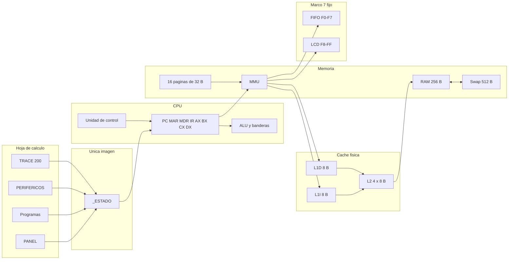
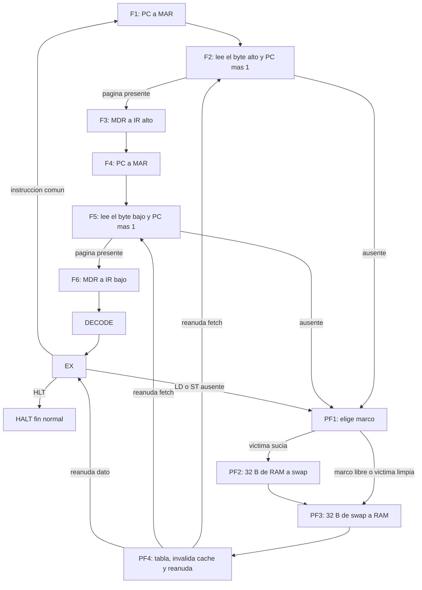
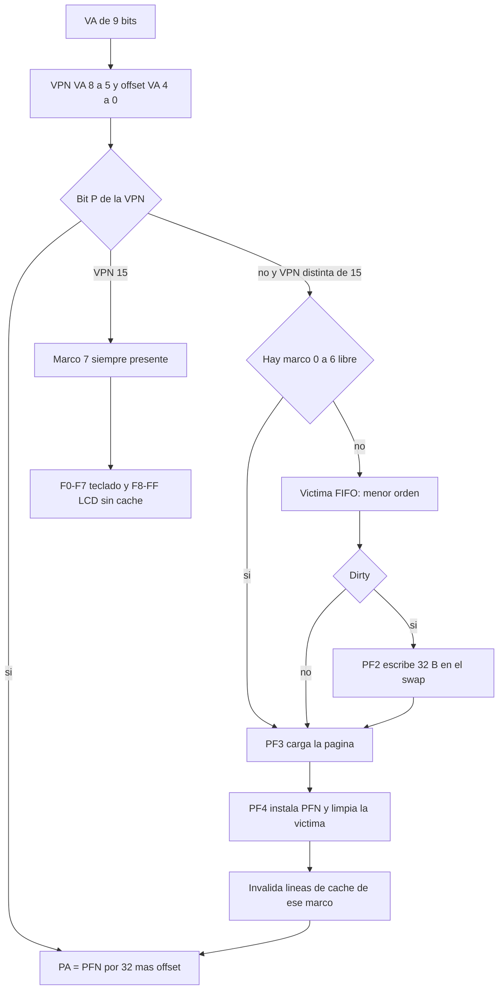
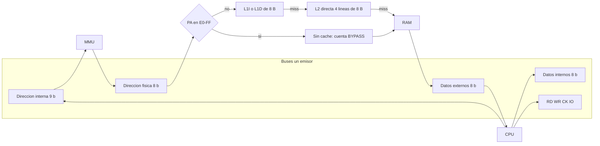
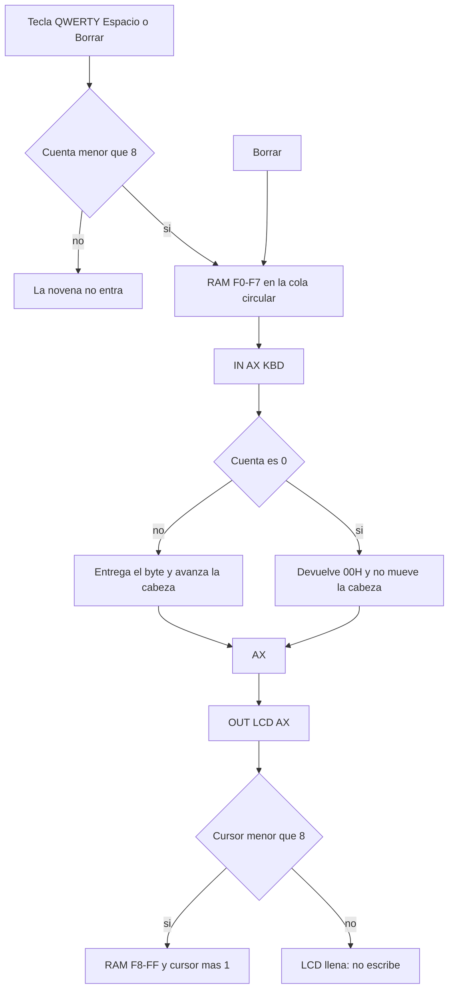

# Arquitectura

Volver a [README.md](../README.md). Manual: [manual.md](manual.md). ISA: [ISA.md](ISA.md). Palabra de control: [control-word.md](control-word.md).

La imagen vive en la hoja oculta `_ESTADO`. PANEL, Programas, PERIFERICOS y TRACE leen o escriben esa imagen. No hay una segunda RAM. El diálogo `Laboratorio.html` pide el mismo estado por `simLabPaso` y `simLabEstado`.

Fuente del diagrama: [diagramas/arquitectura.mmd](diagramas/arquitectura.mmd).

## Ciclo

Cada llamada a `simMicroPaso` ejecuta la fase actual y deja la siguiente. Fetch lee dos bytes. El alto entra en F2 y el bajo en F5. PC aumenta en cada una de esas lecturas. Decode no mueve registros. Execute depende del opcode. `HLT` pasa a `HALT` y ahí se queda.

Si la VPN no está presente, ese paso se anota como PF1 y elige marco. La víctima sucia pasa por PF2 antes de PF3. PF4 actualiza la tabla, invalida las líneas de caché de ese marco y reanuda F2, F5 o EX, según dónde se cortó el acceso.

Fuente: [diagramas/ciclo.mmd](diagramas/ciclo.mmd).

## Traducción y reemplazo

La dirección virtual tiene 9 bits. La VPN son los bits 8 a 5 y el desplazamiento los bits 4 a 0. La dirección física es `PFN * 32 + desplazamiento`, de 8 bits. Hay 16 páginas. Los marcos 0 a 6 se reemplazan. El marco 7 pertenece a la VPN 15, está siempre presente y no puede ser víctima. Un fallo pedido sobre la VPN 15 termina en `ERROR`.

La política guardada con los programas es FIFO: sale la página con menor `orden`. El código también sabe elegir por `uso` si la política es `LRU`. Esa política no es la de P1, P2 ni P3, y no se midió en la hoja.

En el P3 medido hubo 11 fallos, en este orden de VPN: 0, 2, 5, 9, 14, 3, 7, 11, 0, 12, 4. Los siete primeros ocupan los marcos 0 a 6. Los cuatro siguientes reemplazan. El único write-back fue la VPN 9, sucia, al salir del marco 3 cuando entró la VPN 4. El rótulo «Último fallo» se queda en el último evento. No significa que la CPU siga en fallo: P3 termina en `HLT`.

Fuente: [diagramas/paginacion.mmd](diagramas/paginacion.mmd).

## Caché y buses

Hay cuatro buses de datos o dirección y las líneas RD, WR, CK e IO. Cada bus tiene un emisor. Si dos quieren escribir, el paso pasa a `ERROR` y no actualiza el destino.

L1I y L1D tienen una línea de 8 bytes. L2 es directa, índice `(PA >> 3) & 3`, etiqueta física `PA >> 5`. Se consulta después de la MMU. Escritura inmediata y asignación en fallo. La línea no tiene bit dirty. Un acierto de escritura en L1D actualiza la RAM y, si la línea de L2 coincide, también ese byte. Ese mantenimiento suma `mant` y no entra en la tasa de L2. L2 solo cuenta la demanda que llega por un fallo de L1.

Las direcciones físicas `E0`–`FF` no consultan la caché. El contador anota `BYPASS`. Al reemplazar un marco se invalidan las líneas cuya base cae en esos 32 bytes.

En el P3 medido: L1I 19 aciertos y 3 fallos (86,4 %), L1D 0 aciertos y 9 fallos (5 de `LD` y 4 de `ST`), L2 0 aciertos y 12 fallos. 3 + 9 = 12.

Fuente: [diagramas/cache-buses.mmd](diagramas/cache-buses.mmd).

## Teclado y LCD

La cola es circular de 8 bytes en `F0`–`F7`, con cabeza, cola y cuenta. Borrar retrocede la cola y pone ese byte en 0. `IN` lee la cabeza. Si la cuenta es 0, el registro destino recibe `00` y la cabeza no se mueve. `OUT` escribe en `F8` más el cursor, hasta 8 caracteres. El noveno `OUT` no avanza. Ninguno de los dos pasa por L1 ni por L2.

Fuente: [diagramas/es.mmd](diagramas/es.mmd).

## Traza

`SIM_TRAZA_MAX` vale 200. Cada micro-paso empuja una fila y, al pasar de 200, se olvida la más vieja. La pestaña TRACE muestra esas 200 filas. El panel solo enseña los 12 últimos. P3 usó 141, así que cupo entero.

## Hoja y diálogo

El panel pone registros y ALU a la izquierda y la RAM de 16×16 a la derecha. La caché, las dos mitades de la memoria virtual y la tabla quedan más abajo: en una ventana de 1280 px de ancho se ven unos 750 px útiles y el resto pide scroll. No hay botones HEX, DEC, BIN ni INSTRU. El diálogo auxiliar dibuja cables en el hueco entre columnas. No es el diseño de la hoja, y la hoja no pretende copiarlo al píxel.
